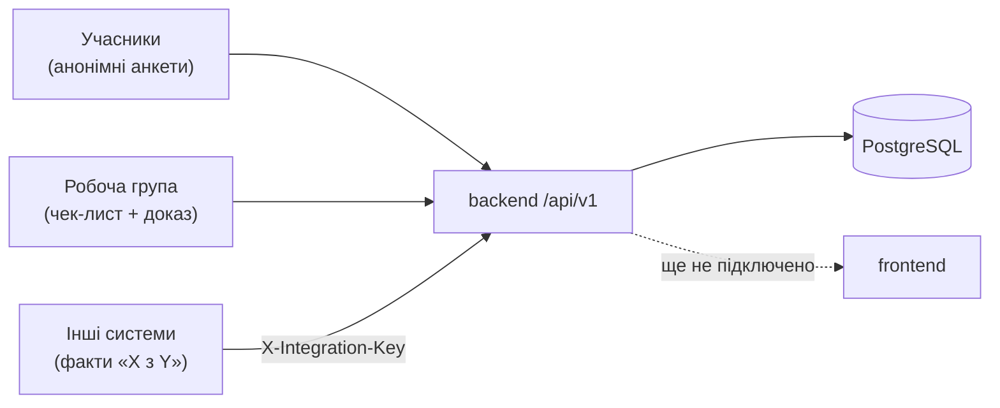

# hack-4-bitec-draft

Integrity Management Dashboard — завдання 3 хакатону BITEC: цифрова система оцінювання доброчесності у вищому військовому
навчальному закладі за Рекомендаціями НУОУ і Моделлю зрілості НАЗК. Лише синтетичні дані, без ШІ в розрахунках, працює в закритому контурі.

## Архітектура

```
hack-4-bitec-draft/
├── backend/                 API: FastAPI + SQLAlchemy 2 + PostgreSQL 16 + Alembic, JWT
│   ├── app/
│   │   ├── routers/         HTTP-маршрути /api/v1, по файлу на модуль (див. таблицю нижче)
│   │   ├── services/        логіка: scoring.py (розрахунок індексу), methodology.py (усі ваги й пороги),
│   │   │                    facts.py (факти), results.py (знімки, історія, порівняння), questionnaires.py …
│   │   ├── seed/data/       анкети 1–3 і чек-лист з Додатків Б і В у JSON
│   │   ├── models.py        модель даних; audit.py — журнал дій; security.py — ролі
│   │   └── main.py
│   ├── migrations/          Alembic
│   ├── scripts/demo_wave.py повна демо-хвиля одним запуском
│   └── tests/               pytest (за замовчуванням на SQLite)
├── frontend/                UI: Vite + React 19 + TypeScript + Tailwind 4 + Recharts
│   ├── src/pages/           екрани (див. таблицю нижче)
│   ├── src/components/      ui/ базові, dashboard/ графіки й картки, layout/ оболонка й навігація
│   ├── src/lib/             логіка UI: scoring/, recommendations.ts, measures.ts, access.ts (ролі й маршрути)
│   ├── src/demo/            синтетичні дані, перемикач ролей і закладів
│   └── docs/                дизайн-система, бриф, відомі обмеження, пропозиція API-контракту
├── docs/
│   ├── backend.md           ролі, модель даних, API
│   ├── integrity-index.md   методика Integrity Index v2
│   ├── run.md               запуск і перевірки
│   ├── api/openapi.json     контракт бекенду
│   └── raw/ md/ tools/      джерела хакатону: оригінали, Markdown, конвертери
├── docker-compose.yml       db + backend (frontend — окремий профіль, див. run.md)
├── AGENTS.md                правила роботи з репозиторієм для людей і агентів
└── .claude/                 налаштування Claude Code і скіл ingest-docs
```



- **Backend** зберігає анкети, хвилі, анонімні відповіді (окремо від факту участі), чек-лист і факти з інших систем. Після закриття хвилі він рахує
  Integrity Index і зберігає незмінний знімок на кожен підрозділ. Кожне число має поле `rule` з поясненням.
- **Frontend** — дашборд керівника, розклад індексу, порівняння, рекомендації, трекер заходів, звіт і кабінет учасника.
  Поки що працює на власних синтетичних даних (`frontend/src/demo`) і має свою пропозицію контракту (`frontend/docs/api/openapi.yaml`).
  Її ще треба звести з бекендовим `docs/api/openapi.json` і підключити фронтенд до API: відповідність операцій і відповіді на питання фронтенду —
  [`docs/api/frontend-mapping.md`](docs/api/frontend-mapping.md).

## Модулі

Модулі з умови завдання і де вони реалізовані («—» — ще немає).

| Модуль | Backend | Frontend |
|---|---|---|
| Assessment Manager — хвилі, учасники, підрозділи | `routers/campaigns.py`, `routers/admin.py` | `/manage` (заглушка) |
| Digital Questionnaire — анкети 1–3, конструктор, версії | `routers/questionnaires.py`, `routers/respond.py` | `/s/:token` опитування, `/surveys` (заглушка) |
| Evidence Repository — чек-лист, підтвердження за доказом | `routers/checklist.py` | `/checklist` (заглушка) |
| Integrity Index Engine — детермінований розрахунок | `services/scoring.py`, `services/methodology.py`, `routers/results.py` | `/explain` розклад індексу, `lib/scoring/` |
| Executive Dashboard — один екран | `GET /dashboard` | `/` |
| Comparative Analytics — РГ / ОС / експерти / факти, динаміка | `routers/results.py` (history, compare), `routers/indicators.py` (факти, сигнали ризику) | `/compare`, `/trends`, `/institutions` |
| Recommendations Engine — явні правила | `services/recommendations.py`, `routers/recommendations.py`, каталог з Додатку Д | `/recommendations`, `lib/recommendations.ts` |
| Recommendations Tracker — відповідальний, строк, статус | `routers/measures.py`, синхронізація з темою 2 (`routers/integrations.py`) | `/tracker`, `lib/measures.ts` |
| Audit Trail — журнал дій | `audit.py` (ланцюжок хешів), `GET /admin/audit-log`, `POST /admin/audit-log/verify` | `/audit` (заглушка) |
| Reporting Module | `GET /campaigns/{id}/report?format=json\|csv` | `/reports` |
| Кабінет учасника — узагальнені результати свого підрозділу | `GET /me/results` | `/me` |
| Інтеграція з іншими системами | `POST /indicators` (ключ на джерело), тема 2: `/integrations/theme2/*` | `/integrations` карта інтеграції |
| Асистент (опційно, вимкнено) | `POST /assistant/ask` | — |

Методика індексу — [`docs/integrity-index.md`](docs/integrity-index.md), ролі й API — [`docs/backend.md`](docs/backend.md).

## Запуск

```bash
cp .env.example .env && docker compose up --build   # PostgreSQL + API → http://localhost:8000/docs
cd frontend && npm ci && npm run dev                  # UI на демо-даних → http://localhost:5173
```

Деталі, демо-хвилі, логіни й перевірки — [`docs/run.md`](docs/run.md).

## Документація

| Що | Де |
|---|---|
| Умова завдання й Рекомендації НУОУ (Markdown) | [`docs/README.md`](docs/README.md) |
| Бекенд: ролі, модель даних, API | [`docs/backend.md`](docs/backend.md), [`backend/README.md`](backend/README.md) |
| Фронтенд: дизайн-система, відомі обмеження | [`frontend/docs/DESIGN_SYSTEM.md`](frontend/docs/DESIGN_SYSTEM.md), [`frontend/docs/KNOWN_ISSUES.md`](frontend/docs/KNOWN_ISSUES.md) |
| Правила роботи з репозиторієм: гілки, коміти | [`AGENTS.md`](AGENTS.md) |
