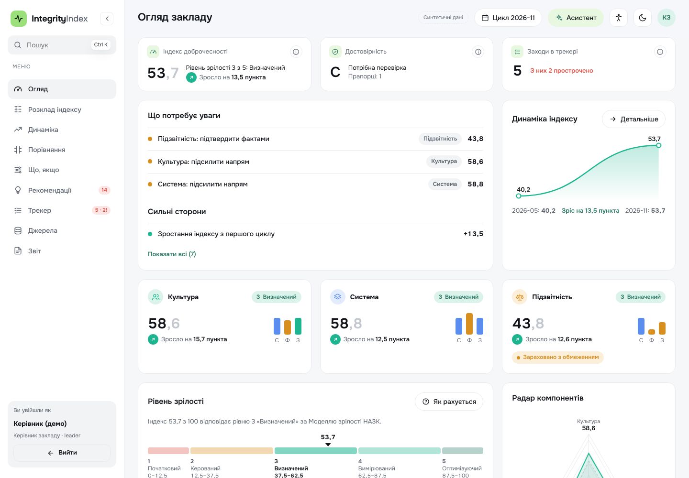
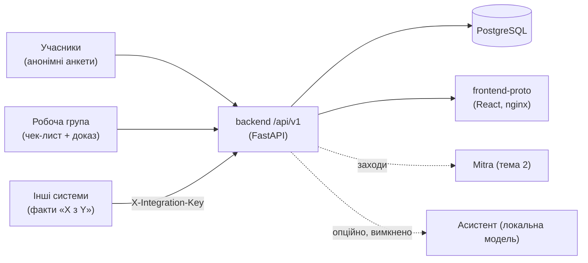

# Integra: цифрова система оцінювання доброчесності ВВНЗ

**Команда White Hedgehogs · Завдання 3. Оцінювання стану доброчесності - Integrity Management Dashboard**



## [Робоча версія](https://integra.csit-mitit.com/) (роль перемикається в меню)

## Проблема і користувач

Користувачі — керівник вищого військового навчального закладу, уповноважена особа з питань запобігання корупції та робоча група, а також
особовий склад, експерти й курсанти, які відповідають на анкети. Зараз оцінювання доброчесності за Рекомендаціями НУОУ йде на папері
й у таблицях: анкети зводять вручну, рівні зрілості рахують в Excel, а звіт за Додатком Г готують тижнями. Через це картина запізнюється,
самооцінку робочої групи ніхто не звіряє з фактами, а люди відповідають обережно, бо не певні в анонімності. Integra дає керівникові
чесну й пояснювану картину системи доброчесності за Моделлю зрілості НАЗК і доводить рекомендації до виконаних заходів. Система оцінює
**систему, а не людей**, і не придатна для покарання: рейтингу підрозділів і поіменних даних у ній немає.

## Що робить рішення

1. **Хвиля оцінювання:** анкети 1–3 (Додаток В) і контрольний чек-лист (Додаток Б); особовий склад проходить анкету анонімно за QR-кодом
   або одноразовим посиланням, робоча група додає до пунктів чек-листа файли-докази.
2. **Integrity Index за Моделлю зрілості НАЗК:** детермінований розрахунок за трьома компонентами (Культура, Система, Підзвітність) і
   п'ятьма рівнями; на екрані «Розклад індексу» кожне число показує правило, яким його пораховано.
3. **Зіставлення самооцінки з фактами:** відповіді робочої групи, особового складу й експертів порівнюються між собою і з об'єктивними
   показниками з інших систем («X з Y»); правило реальності не дає самооцінці бути вищою за факти більше ніж на рівень.
4. **Dashboard керівника на одному екрані:** рівень, достовірність A / B / C з причинами, динаміка між хвилями, «Що потребує уваги».
5. **Від рекомендації до дії:** рекомендації за явними правилами з каталогом заходів Додатку Д; керівник ухвалює рішення, захід отримує
   відповідального, строк і статус («виконано» лише з доказом), а ефект перевіряє наступна хвиля. Режим «Що, якщо» показує, що дасть захід.
6. **Звіт за Додатком Г** одним кліком у Word, Excel або CSV.
7. **Запобіжники:** відповіді групи менш ніж з 5 людей не показуються, відповідь зберігається окремо від факту участі, журнал дій має
   ланцюжок хешів, принцип двох осіб для привілейованих дій, ШІ не ухвалює жодних висновків.

## Як запустити

Заздалегідь установити: **Git** і **Docker** з Docker Compose v2 (Docker Desktop на Windows і macOS). Порти 8080 і 8000 мають бути вільні.

1. Клонувати репозиторій: `git clone https://github.com/caaaaanek/hack-4-bitec.git && cd hack-4-bitec`
2. Створити файл налаштувань: `cp .env.example .env`
3. У `.env` вписати три значення: `POSTGRES_PASSWORD` (будь-який пароль), `JWT_SECRET` (не коротше 32 символів, наприклад вивід
   `python -c "import secrets; print(secrets.token_hex(32))"`) і `DEMO_PASSWORD` (не коротше 8 символів).
4. Запустити: `docker compose up --build`. Перший запуск триває кілька хвилин: створюються база, демо-підрозділи й дві закриті хвилі.
5. Відкрити http://localhost:8080 і увійти як `leader` (керівник) з паролем `DEMO_PASSWORD`. Інші ролі: `admin`, `coordinator`,
   `department`, `auditor`, `wg1`, `staff01`, `expert1`. Swagger API: http://localhost:8000/docs.

Без Docker і інші режими (одним процесом, лише інтерфейс на демо-даних, smoke-перевірка) описано в [`docs/run.md`](docs/run.md).

## Як влаштовано

**Стек.** Бекенд: Python 3.13, FastAPI, SQLAlchemy 2, PostgreSQL 16, Alembic, JWT. Інтерфейс: React 18 + Vite, віддає nginx. Усе
піднімається одним `docker compose up`. Тести: pytest (понад 400 тестів бекенду), GitHub Actions на PostgreSQL.



- **Backend** зберігає анкети, хвилі, анонімні відповіді (окремо від факту участі), чек-лист і факти з інших систем. Після закриття
  хвилі він рахує Integrity Index і зберігає незмінний знімок на кожен підрозділ. Кожне число має поле `rule` з поясненням.
- **Frontend** (`frontend-proto/`): дашборд керівника, розклад індексу, порівняння, рекомендації, трекер заходів, звіт і кабінет
  учасника. Після входу всі дані йдуть з бекенду; без API сторінка працює на демо-даних.

**Де основна логіка.** `backend/app/services/methodology.py` — усі ваги й пороги в одному місці; `scoring.py` — розрахунок індексу;
`recommendations.py` — правила рекомендацій; `results.py` — знімки, історія й порівняння; `audit.py` — журнал з ланцюжком хешів.

```
hack-4-bitec/
├── backend/                 API: FastAPI + SQLAlchemy 2 + PostgreSQL 16 + Alembic, JWT
│   ├── app/
│   │   ├── routers/         HTTP-маршрути /api/v1, по файлу на модуль (див. таблицю нижче)
│   │   ├── services/        логіка: scoring.py, methodology.py, recommendations.py, facts.py, results.py …
│   │   ├── seed/data/       анкети 1–3, чек-лист (Додатки Б і В) і каталог заходів (Додаток Д) у JSON
│   │   ├── models.py        модель даних; audit.py — журнал дій; security.py — ролі
│   │   └── main.py
│   ├── adapters/            демо-адаптери джерел фактів (синтетичні дані)
│   ├── migrations/          Alembic
│   ├── scripts/             demo_wave.py, smoke.py, gen_docs.py, export_openapi.py
│   └── tests/               pytest (за замовчуванням на SQLite)
├── frontend-proto/          інтерфейс: React + Vite → dist/ → nginx у Docker
├── docs/                    документація (перелік нижче)
├── deploy/                  розгортання в Coolify і локальна модель для асистента
├── docker-compose.yml       db + backend + frontend одним docker compose up
└── AGENTS.md                правила роботи з репозиторієм для людей і агентів
```

### Правила, що ухвалюють висновки (п. 4 Політики використання ШІ)

Усі бали, рівні, прапорці достовірності, рекомендації й статуси дає детермінований код за явними правилами або підтверджує людина.
Модель ШІ не бере участі в жодному розрахунку. Повна методика — [`docs/integrity-index.md`](docs/integrity-index.md).

| Висновок | Правило | Де в коді |
|---|---|---|
| Бал самооцінки компонента | `S = 0,35·ОС + 0,25·РГ + 0,20·Експерти + 0,20·Чек-лист`; група з менш ніж k = 5 відповідей випадає, її вага ділиться між рештою | `methodology.py`, `scoring.py` |
| Рівень за фактами | частка «X з Y» переводиться в рівень 1–5 за порогами; кількість знайдених проблем на бал не впливає | `methodology.py`, `facts.py` |
| Правило реальності | якщо `S > F + 25`, то `L = F + 25` і прапорець `self_not_confirmed`; факти лише обмежують самооцінку, ніколи не піднімають | `scoring.py` |
| Рівень індексу | `II = середнє трьох компонентів`; межі рівнів 12,5 / 37,5 / 62,5 / 87,5; загальний рівень не вищий за найслабший компонент + 1 | `scoring.py` |
| Достовірність A / B / C | A — немає прапорців; B — 1–2 незначних; C — хоч один серйозний або 3 незначних (низька участь, розрив РГ і ОС > 25, «надто ідеальні» анкети тощо) | `scoring.py` |
| Рекомендації | правила `cut`, `gap`, `weakest`, `fact`, `checklist`, `participation`, `perfect`, `risk` … з пріоритетом і заходами Додатку Д | `recommendations.py` |
| Рішення за рекомендацією, статус заходу | ухвалює посадова особа; «виконано» лише з файлом-доказом; ефект — зміна компонента в наступній хвилі (\|Δ\| < 5 балів — у межах похибки) | `routers/measures.py` |
| Сигнали ризику, «підгонка» показників | явні правила дають **ознаку для перевірки**, а не висновок про людину | `services/goodhart.py`, `routers/indicators.py` |

Як перевірити: `GET /api/v1/methodology` повертає всі ваги й пороги; кожне число й кожна рекомендація має поле `rule`;
тест `backend/tests/test_results.py::test_same_input_gives_same_snapshot` показує, що той самий вхід дає той самий знімок;
асистент на ШІ вимкнений за замовчуванням (`ASSISTANT_ENABLED=false`), і вся система працює без нього.

### Модулі

Модулі з умови завдання і де вони реалізовані. Фронтенд — `frontend-proto` (маршрути `#…`); «—» — окремого екрана ще немає.

| Модуль | Backend | Frontend |
|---|---|---|
| Assessment Manager — хвилі, учасники, підрозділи | `routers/campaigns.py` (зміна чернетки, явні учасники, імпорт CSV псевдонімів, одноразові посилання, QR для зали), `routers/admin.py` | `#manage` хвилі, QR |
| Digital Questionnaire — анкети 1–3, конструктор, версії | `routers/questionnaires.py`, `routers/respond.py` (вхід або анонімно за QR чи посиланням) | `/q/<код>`, `/s/<токен>`, `#survey`, `#surveys` |
| Evidence Repository — чек-лист, файли-докази з sha256 | `routers/checklist.py`, `services/evidence.py` | `#checklist` з файлами |
| Integrity Index Engine — детермінований розрахунок | `services/scoring.py`, `services/methodology.py`, `routers/results.py` | `#explain` розклад індексу |
| Executive Dashboard — один екран | `GET /dashboard` | `#overview` |
| Comparative Analytics — РГ / ОС / експерти / факти, динаміка | `routers/results.py` (history, compare), `routers/indicators.py` (факти, сигнали ризику) | `#compare`, `#trends`, `#institutions` |
| Recommendations Engine — явні правила | `services/recommendations.py`, `routers/recommendations.py`, каталог з Додатку Д | `#recs`, `#whatif` «Що, якщо» |
| Recommendations Tracker — відповідальний, строк, статус | `routers/measures.py`, синхронізація з темою 2 (`routers/integrations.py`) | `#tracker` |
| Audit Trail — журнал дій | `audit.py` (ланцюжок хешів), `GET /admin/audit-log`, `POST /admin/audit-log/verify`; якір назовні (файл WORM / мітка часу RFC 3161, `services/audit_anchor.py`); перегляди чужих підрозділів — `GET /admin/result-views` | `#audit` з перевіркою; якір і перегляди — API готове |
| Reporting Module | `GET /campaigns/{id}/report?format=json\|csv\|xlsx\|docx` | `#report` |
| Кабінет учасника — узагальнені результати свого підрозділу | `GET /me/results`, за посиланням `GET /respond/results` | `#me`, `/s/<токен>` після закриття |
| Інтеграція з іншими системами | `POST /indicators` (ключ на джерело), тема 2: `/integrations/theme2/*`, вхід через проксі організації (`POST /auth/proxy`), `ROOT_PATH` | `#sources` джерела фактів |
| «Адвокат диявола» — питання аудитора до хвилі за правилами | `GET /campaigns/{id}/devils-advocate` | `#advocate` «Питання перевірки» |
| Агент-черговий — що впало, чому, як виправити | `GET /agent/digest` | дзвіночок у шапці й «Що потребує уваги» |
| Аналіз нормативки — які пункти зачіпає новий наказ | `POST /normative/analyze` (локальний пошук, без моделей) | `#normative` «Нормативка» |
| Автопілот хвилі — відкриття, нагадування всім, закриття, звіт | `PUT /campaigns/{id}/autopilot`, `POST /autopilot/tick`, `GET /me/notifications` | розділ у «Керуванні циклом», дзвіночок |
| Флешкартки доброчесності — джерело охоплення навчанням | `/learning/*` | `#learn` «Навчання» |
| Детектор відвертості — непрямі питання й «дзеркало», картка «Що люди бояться сказати прямо» | `services/candor.py`, `GET /campaigns/{id}/candor`, `candor_card` у `GET /dashboard` | — (API готове; форма анкети працює й без змін: непряме питання приходить як вибір «0…N») |
| Урна з трьома ключами — відповіді розшифрують лише двоє з трьох власників | `services/urn.py`, `routers/urn.py` | — (API готове) |
| Квитанції — жетон зі сліпим підписом, перевірка «моя відповідь урахована» | `services/ballots.py`, `/campaigns/{id}/questionnaires/{qid}/ballot`, `/respond/ballot`, `/respond/receipts/{квитанція}` | — (API готове) |
| Детектор Гудхарта, лотерея перевірок, шлях до наступного рівня, брифінг, стійкість ваг | `services/goodhart.py`, `services/planning.py`, `routers/insights_plus.py` | — (API готове) |
| Довідники (категорії, посади, факти з власниками джерел), Департамент, реєстр ризиків, принцип двох осіб, запрошення | `routers/dictionaries.py`, `routers/department.py`, `routers/risks.py`, `services/approvals.py`, `services/invites.py` | — (API готове) |
| Профіль безпеки — `SECURITY_PROFILE=production` вмикає всі запобіжники разом | `config.py` (`PRODUCTION_PROFILE`), `GET /config` → `policies` | попередження адміну — API готове |
| Асистент (опційно, вимкнено) | `POST /assistant/ask`, `/api/assistant` (OpenAI-сумісний, `LLM_*`) | кнопка «Асистент» |

## Документація

**Де шукати кожен пункт «Очікуваного формату кінцевого продукту» завдання 3:**

| № | Пункт завдання | Де |
|---|---|---|
| 1 | Робочий MVP або інтерактивний прототип | цей репозиторій, запуск — розділ «Як запустити», демо — розділ «Демонстрація» |
| 2 | Демонстрація оцінювання з цифровими опитувальниками | [`docs/demo-scenario.md`](docs/demo-scenario.md), відео |
| 3 | Приклад автоматичного розрахунку Integrity Index | [`docs/integrity-index.md`](docs/integrity-index.md), розділ «Приклад розрахунку» |
| 4 | Приклад Dashboard керівника | [`docs/dashboard.md`](docs/dashboard.md) |
| 5 | Приклади автоматично сформованих рекомендацій | [`docs/recommendations.md`](docs/recommendations.md) |
| 6 | Механізм захисту анонімності респондентів | [`docs/anonymity.md`](docs/anonymity.md) |
| 7 | Зіставлення самооцінювання з об'єктивними показниками | [`docs/cross-check.md`](docs/cross-check.md) |
| 8 | Розрахунок економії часу | [`docs/time-savings.md`](docs/time-savings.md) |
| 9 | Карта інтеграції з наявними ІС | [`docs/integration-map.md`](docs/integration-map.md) |
| 10 | Аналіз можливих зловживань і запобіжників | [`docs/abuse-analysis.md`](docs/abuse-analysis.md) |
| 11 | Записка «Як ми використали ШІ» | [`docs/ai.md`](docs/ai.md) |
| 12 | Концепція інтеграції з іншими рішеннями у сфері доброчесності | [`docs/ecosystem.md`](docs/ecosystem.md) |

**Усі файли в `docs/`:**

- [`docs/README.md`](docs/README.md) — зміст папки й звідки взято джерела хакатону.
- [`docs/ai.md`](docs/ai.md) — як команда використала ШІ: інструменти, власні рішення, відкинуті варіанти.
- [`docs/demo-scenario.md`](docs/demo-scenario.md) — покроковий демонстраційний сценарій для відео й самостійної перевірки.
- [`docs/role-workflows.md`](docs/role-workflows.md) — що робить кожна роль у повній хвилі оцінювання, від створення до звіту.
- [`docs/integrity-index.md`](docs/integrity-index.md) — методика Integrity Index, формули, пороги, приклад розрахунку.
- [`docs/dashboard.md`](docs/dashboard.md) — блоки Dashboard керівника і що означає кожне число на демо-даних.
- [`docs/recommendations.md`](docs/recommendations.md) — рекомендації, рішення керівника й заходи з демо-прогону.
- [`docs/cross-check.md`](docs/cross-check.md) — зіставлення відповідей РГ, ОС, експертів і фактів з інших систем.
- [`docs/anonymity.md`](docs/anonymity.md) — як забезпечено анонімність, модель загроз і залишкові ризики.
- [`docs/abuse-analysis.md`](docs/abuse-analysis.md) — як рішенням і його показниками можна зловживати і що цьому запобігає.
- [`docs/time-savings.md`](docs/time-savings.md) — скільки часу економить система порівняно з ручним порядком.
- [`docs/integration-map.md`](docs/integration-map.md) — на яких наявних ІС рішення працює як модуль, джерела фактів і потоки даних.
- [`docs/ecosystem.md`](docs/ecosystem.md) — концепція інтеграції з іншими цифровими рішеннями у сфері доброчесності.
- [`docs/features.md`](docs/features.md) — модулі автоматизації: адвокат диявола, агент-черговий, нормативка, автопілот, флешкартки.
- [`docs/backend.md`](docs/backend.md) — ролі, модель даних і повний опис API бекенду.
- [`docs/frontend-backlog.md`](docs/frontend-backlog.md) — що бекенд уже вміє, а окремого екрана для цього ще немає.
- [`docs/analysis-20-11.md`](docs/analysis-20-11.md) — звірка з вимогами станом на 20.11: що виправлено і що лишилось.
- [`docs/run.md`](docs/run.md) — усі способи запуску, демо-логіни, smoke-перевірка, розгортання за проксі.
- [`docs/api/`](docs/api) — контракт API (`openapi.json`) і відповідність екранів маршрутам.
- [`docs/contracts/`](docs/contracts) — контракти інтеграцій: з Mitra (тема 2) і нашого модуля «Перевірки» (декларації, конфлікти інтересів, закупівлі), зі схемами й прикладами.
- [`docs/img/`](docs/img) — скриншоти головних екранів.
- [`docs/raw/`](docs/raw), [`docs/md/`](docs/md), [`docs/tools/`](docs/tools) — оригінали джерел хакатону, їх Markdown-версії та скрипти конвертації.

Інше: [`backend/README.md`](backend/README.md) — запуск бекенду без Docker; [`frontend-proto/README.md`](frontend-proto/README.md) — інтерфейс;
[`AGENTS.md`](AGENTS.md) — правила роботи з репозиторієм.

## Що використали

Не наш код і не наші матеріали. Усе з відкритими ліцензіями, що дозволяють таке використання.

- **Бекенд (Python):** FastAPI, Uvicorn, SQLAlchemy, Alembic, Pydantic, pydantic-settings, psycopg, PyJWT, bcrypt, python-multipart,
  httpx, cryptography (AES-GCM), python-docx, openpyxl, pypdf, tzdata; тести — pytest. Повний перелік з версіями — `backend/requirements*.txt`.
- **Інтерфейс:** React, React DOM, Vite, qrcode-generator, шрифт Onest (SIL Open Font License).
- **Інфраструктура:** PostgreSQL 16, nginx, Docker / Docker Compose, GitHub Actions; діаграма в README — Mermaid.
- **Методичні матеріали й відкриті дані:** «Рекомендації щодо трансформації ВВНЗ» НУОУ (анкети й чек-лист з Додатків Б і В, шаблон
  звіту з Додатку Г, план заходів з Додатку Д), Модель зрілості НАЗК, умова завдання 3. Опційно (`EXTERNAL_FETCH_ENABLED`) — відкриті
  API Prozorro і реєстру декларацій НАЗК; недоступність нічого не ламає.
- **Дані:** лише синтетичні (демо-підрозділи «(демо)», вигадані логіни й факти). Реальних персональних даних і службової інформації немає.
- **Моделі ШІ в продукті:** Gemma (Google, відкриті ваги) через локальну Ollama або шлюз кафедри — лише для опційного асистента, вимкненого
  за замовчуванням. Інструменти ШІ, якими користувалась команда під час розробки, — у [`docs/ai.md`](docs/ai.md).
- **Інші команди:** код інших команд не використано. З Mitra (тема 2) є лише інтеграція через API за спільним контрактом
  (`docs/contracts/integra-mitra.yaml`); ARTEMIDA та інші джерела фактів у демо замінено синтетичними адаптерами (`backend/adapters/`).

## Ліцензія

[MIT](LICENSE)
