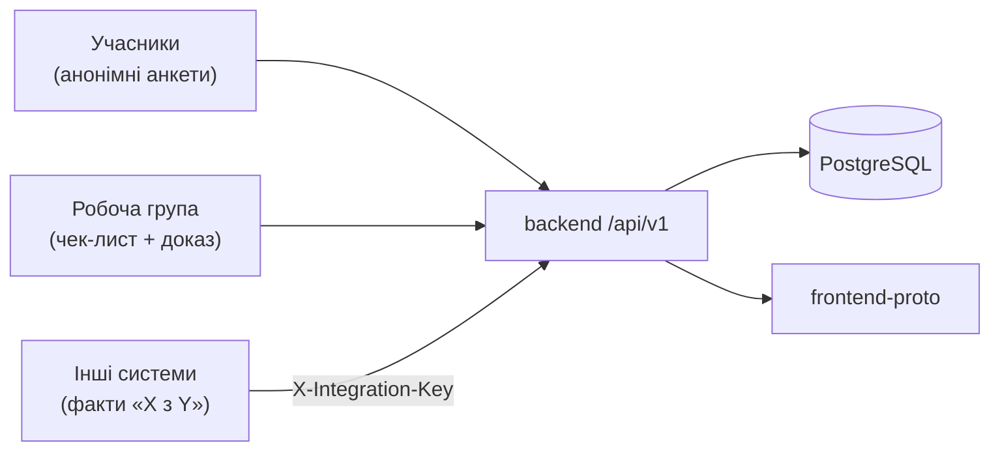

# hack-4-bitec-draft

Integra: рішення завдання 3 хакатону BITEC «Integrity Management Dashboard»: цифрова система оцінювання доброчесності у вищому військовому
навчальному закладі за Рекомендаціями НУОУ і Моделлю зрілості НАЗК. Лише синтетичні дані, без ШІ в розрахунках, працює в закритому контурі.


## Архітектура

```
hack-4-bitec-draft/
├── backend/                 API: FastAPI + SQLAlchemy 2 + PostgreSQL 16 + Alembic, JWT
│   ├── app/
│   │   ├── routers/         HTTP-маршрути /api/v1, по файлу на модуль (див. таблицю нижче)
│   │   ├── services/        логіка: scoring.py (розрахунок індексу), methodology.py (усі ваги й пороги),
│   │   │                    facts.py (факти), results.py (знімки, історія, порівняння), questionnaires.py …
│   │   ├── seed/data/       анкети 1–3 і чек-лист з Додатків Б і В у JSON
│   │   ├── models.py        модель даних; audit.py — журнал дій; security.py — ролі
│   │   └── main.py
│   ├── migrations/          Alembic
│   ├── scripts/demo_wave.py повна демо-хвиля одним запуском
│   └── tests/               pytest (за замовчуванням на SQLite)
├── frontend-proto/          UI (використовується): React + Vite, src/ → npm run build → dist/, nginx у Docker
├── frontend/                попередній UI на React (у compose не використовується)
│   ├── src/pages/           екрани (див. таблицю нижче)
│   ├── src/components/      ui/ базові, dashboard/ графіки й картки, layout/ оболонка й навігація
│   ├── src/lib/             логіка UI: scoring/, recommendations.ts, measures.ts, access.ts (ролі й маршрути)
│   ├── src/demo/            синтетичні дані, перемикач ролей і закладів
│   └── docs/                дизайн-система, бриф, відомі обмеження, пропозиція API-контракту
├── docs/
│   ├── backend.md           ролі, модель даних, API
│   ├── integrity-index.md   методика Integrity Index v2.2
│   ├── run.md               запуск і перевірки
│   ├── anonymity.md         як забезпечено анонімність, модель загроз, залишкові ризики
│   ├── abuse-analysis.md    зловживання й протидія
│   ├── api/openapi.json     контракт бекенду
│   └── raw/ md/ tools/      джерела хакатону: оригінали, Markdown, конвертери
├── docker-compose.yml       db + backend + frontend (nginx) одним docker compose up
├── AGENTS.md                правила роботи з репозиторієм для людей і агентів
└── .claude/                 налаштування Claude Code і скіл ingest-docs
```



- **Backend** зберігає анкети, хвилі, анонімні відповіді (окремо від факту участі), чек-лист і факти з інших систем. Після закриття хвилі він рахує
  Integrity Index і зберігає незмінний знімок на кожен підрозділ. Кожне число має поле `rule` з поясненням.
- **Frontend** — дашборд керівника, розклад індексу, порівняння, рекомендації, трекер заходів, звіт і кабінет учасника.
  Це `frontend-proto/`: після входу всі дані йдуть з бекенду, без API сторінка працює на демо-даних.

## Модулі

Модулі з умови завдання і де вони реалізовані. Фронтенд — `frontend-proto` (маршрути `#…`); «—» — екрана ще немає.

| Модуль | Backend | Frontend |
|---|---|---|
| Assessment Manager — хвилі, учасники, підрозділи | `routers/campaigns.py` (зміна чернетки, явні учасники, імпорт CSV псевдонімів, одноразові посилання, QR для зали), `routers/admin.py` | `#manage` хвилі, QR |
| Digital Questionnaire — анкети 1–3, конструктор, версії | `routers/questionnaires.py`, `routers/respond.py` (вхід або анонімно за QR чи посиланням) | `/q/<код>`, `/s/<токен>`, `#survey`, `#surveys` |
| Evidence Repository — чек-лист, файли-докази з sha256 | `routers/checklist.py`, `services/evidence.py` | `#checklist` з файлами |
| Integrity Index Engine — детермінований розрахунок | `services/scoring.py`, `services/methodology.py`, `routers/results.py` | `#explain` розклад індексу |
| Executive Dashboard — один екран | `GET /dashboard` | `#overview` |
| Comparative Analytics — РГ / ОС / експерти / факти, динаміка | `routers/results.py` (history, compare), `routers/indicators.py` (факти, сигнали ризику) | `#compare`, `#trends`, `#institutions` |
| Recommendations Engine — явні правила | `services/recommendations.py`, `routers/recommendations.py`, каталог з Додатку Д | `#recs`, `#whatif` «Що, якщо» |
| Recommendations Tracker — відповідальний, строк, статус | `routers/measures.py`, синхронізація з темою 2 (`routers/integrations.py`) | `#tracker` |
| Audit Trail — журнал дій | `audit.py` (ланцюжок хешів), `GET /admin/audit-log`, `POST /admin/audit-log/verify`; якір назовні (файл WORM / мітка часу RFC 3161, `services/audit_anchor.py`); перегляди чужих підрозділів — `GET /admin/result-views` | `#audit` з перевіркою; якір і перегляди — API готове |
| Reporting Module | `GET /campaigns/{id}/report?format=json\|csv\|xlsx\|docx` | `#report` |
| Кабінет учасника — узагальнені результати свого підрозділу | `GET /me/results`, за посиланням `GET /respond/results` | `#me`, `/s/<токен>` після закриття |
| Інтеграція з іншими системами | `POST /indicators` (ключ на джерело), тема 2: `/integrations/theme2/*`, вхід через проксі організації (`POST /auth/proxy`), `ROOT_PATH` | `#sources` джерела фактів |
| «Адвокат диявола» — питання аудитора до хвилі за правилами | `GET /campaigns/{id}/devils-advocate` | `#advocate` «Питання перевірки» |
| Агент-черговий — що впало, чому, як виправити | `GET /agent/digest` | дзвіночок у шапці й «Що потребує уваги» |
| Аналіз нормативки — які пункти зачіпає новий наказ | `POST /normative/analyze` (локальний пошук, без моделей) | `#normative` «Нормативка» |
| Автопілот хвилі — відкриття, нагадування всім, закриття, звіт | `PUT /campaigns/{id}/autopilot`, `POST /autopilot/tick`, `GET /me/notifications` | розділ у «Керуванні циклом», дзвіночок |
| Флешкартки доброчесності — джерело охоплення навчанням | `/learning/*` | `#learn` «Навчання» |
| Детектор відвертості — непрямі питання й «дзеркало», картка «Що люди бояться сказати прямо» | `services/candor.py`, `GET /campaigns/{id}/candor`, `candor_card` у `GET /dashboard` | — (API готове; форма анкети працює й без змін: непряме питання приходить як вибір «0…N») |
| Урна з трьома ключами — відповіді розшифрують лише двоє з трьох власників | `services/urn.py`, `routers/urn.py` | — (API готове) |
| Квитанції — жетон зі сліпим підписом, перевірка «моя відповідь урахована» | `services/ballots.py`, `/campaigns/{id}/questionnaires/{qid}/ballot`, `/respond/ballot`, `/respond/receipts/{квитанція}` | — (API готове) |
| Детектор Гудхарта, лотерея перевірок, шлях до наступного рівня, брифінг, стійкість ваг | `services/goodhart.py`, `services/planning.py`, `routers/insights_plus.py` | — (API готове) |
| Довідники (категорії, посади, факти з власниками джерел), Департамент, реєстр ризиків, принцип двох осіб, запрошення | `routers/dictionaries.py`, `routers/department.py`, `routers/risks.py`, `services/approvals.py`, `services/invites.py` | — (API готове) |
| Профіль безпеки — `SECURITY_PROFILE=production` вмикає всі запобіжники разом | `config.py` (`PRODUCTION_PROFILE`), `GET /config` → `policies` | попередження адміну — API готове |
| Асистент (опційно, вимкнено) | `POST /assistant/ask`, `/api/assistant` (OpenAI-сумісний, `LLM_*`) | кнопка «Асистент» |

Методика індексу — [`docs/integrity-index.md`](docs/integrity-index.md), ролі й API — [`docs/backend.md`](docs/backend.md).
Що з «API готове» показати на екранах і як — [`docs/frontend-backlog.md`](docs/frontend-backlog.md).

## Запуск

```bash
cp .env.example .env && docker compose up --build   # PostgreSQL + API + UI → http://localhost:8080 (API: :8000/docs)
# без Docker, усе одним процесом: cp backend/.env.example backend/.env && ./run-local.sh → http://localhost:8000
# лише UI на демо-даних: cd frontend-proto && npm install && npm run dev
```

Деталі, демо-хвилі, логіни й перевірки — [`docs/run.md`](docs/run.md).

## Документація

| Що | Де |
|---|---|
| Умова завдання й Рекомендації НУОУ (Markdown) | [`docs/README.md`](docs/README.md) |
| Бекенд: ролі, модель даних, API | [`docs/backend.md`](docs/backend.md), [`backend/README.md`](backend/README.md) |
| Що бекенд уже вміє, а екрана ще немає | [`docs/frontend-backlog.md`](docs/frontend-backlog.md) |
| Демонстраційний сценарій (результат 2) | [`docs/demo-scenario.md`](docs/demo-scenario.md) |
| Методика й приклад розрахунку Integrity Index (результат 3) | [`docs/integrity-index.md`](docs/integrity-index.md) |
| Dashboard керівника (результат 4) | [`docs/dashboard.md`](docs/dashboard.md) |
| Рекомендації з прогону (результат 5) і зіставлення з фактами (результат 7) | [`docs/recommendations.md`](docs/recommendations.md), [`docs/cross-check.md`](docs/cross-check.md) |
| Захист анонімності (результат 6) і аналіз зловживань (результат 10) | [`docs/anonymity.md`](docs/anonymity.md), [`docs/abuse-analysis.md`](docs/abuse-analysis.md) |
| Модулі підготовки й автоматизації: адвокат диявола, агент-черговий, нормативка, автопілот, флешкартки | [`docs/features.md`](docs/features.md) |
| Економія часу (результат 8) | [`docs/time-savings.md`](docs/time-savings.md) |
| Карта інтеграції і концепція екосистеми (результати 9 і 12) | [`docs/integration-map.md`](docs/integration-map.md), [`docs/ecosystem.md`](docs/ecosystem.md) |
| Як ми використали ШІ (результат 11) | [`docs/ai.md`](docs/ai.md) |
| Фронтенд (`frontend-proto`, саме він у `docker compose`) | [`frontend-proto/README.md`](frontend-proto/README.md), [`frontend-proto/CLAUDE.md`](frontend-proto/CLAUDE.md) |
| Попередній фронтенд (`frontend/`, архів, у compose не використовується) | [`frontend/docs/DESIGN_SYSTEM.md`](frontend/docs/DESIGN_SYSTEM.md), [`frontend/docs/KNOWN_ISSUES.md`](frontend/docs/KNOWN_ISSUES.md) |
| Правила роботи з репозиторієм: гілки, коміти | [`AGENTS.md`](AGENTS.md) |
