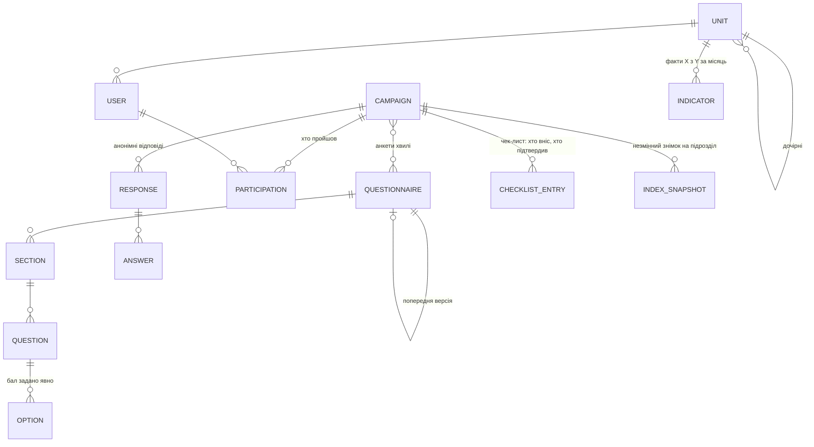
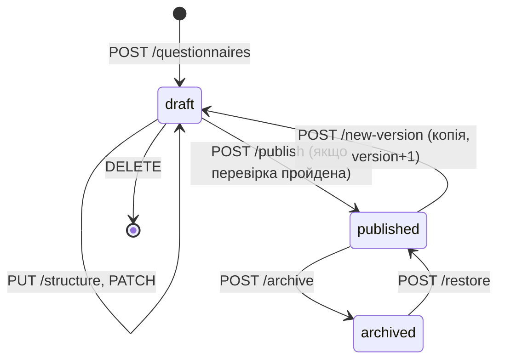

# Backend: опитувальники, конструктор анкет, ролі, Integrity Index, рекомендації, заходи

Стек: Python 3.13, FastAPI, SQLAlchemy 2, PostgreSQL 16, Alembic, JWT. Працює без зовнішніх хмарних сервісів і без ШІ.

## Ролі

Сім ролей. Адміністраторів двоє — **уповноважений** (`admin`) і **технічний адміністратор** (`coordinator`), це два
облікові записи двох людей. Привілейований крок одного підтверджує інший або внутрішній аудит (розділ «Два адміністратори,
зони, принцип двох осіб» нижче). Інфраструктурний адміністратор (сервер, БД, бекапи) ролі в застосунку не має.

| Роль | Хто це | Що може | Чого не може |
|---|---|---|---|
| `respondent` | Учасник оцінювання | Проходить призначені анкети, бачить узагальнені результати | Решту |
| `respondent` + `working_group` | Член робочої групи | Анкета 1; вносить пункти чек-листа з документами (лише призначені йому, якщо є призначення) | Підтверджувати пункти |
| `admin` | Уповноважений (1-й адмін) | Хвилі своєї **зони**: створення, k, учасники з наявних облікових записів, посилання й QR, призначення чек-листа, автопілот, урна, «Перевірки», реєстр ризиків, факти. Результати лише агрегатами з порогом k. Журнал дій. Підтверджує запити техадміна | Люди, ролі, підрозділи, довідники людей, анкети; хвилі й підрозділи поза своєю зоною |
| `leader` | Керівник | Дашборд, результати, динаміка, факти, рекомендації, рішення, заходи. **Деталі бачить лише свого підрозділу** (без `unit_id` — кореневого); про дочірні — розподіл рівнів без назв (`GET /units/{id}/children-levels`). Заходи веде в усьому своєму піддереві. `LEADER_CHILD_DETAILS=true` повертає старе правило | Адміністрування |
| `auditor` | Внутрішній аудит | Читання результатів, заходів і журналу своєї зони; підтверджує пункти чек-листа (`CHECKLIST_CONFIRMERS`) і **відкриття хвилі**; якір журналу; лотерея перевірок; звіт «хто дивився дочірні підрозділи» | Інший запис |
| `department` | Департамент | Анкети й версії (конструктор, публікація, архів); зведення закладів свого піддерева кожен окремо, без рейтингу (`/department/*`); читання реєстрів ризиків своїх закладів | Хвилі, люди, зміна довідника категорій |
| `coordinator` | Технічний адміністратор (2-й адмін) | Користувачі (лише запрошення, без паролів), імпорт людей CSV, підрозділи, ролі, категорії, посади, зведення людей і підрозділів | Хвилі, результати, журнал, паролі; нічого не підтверджує; собі змінює лише ім'я |

Роль `commissioner` прибрано (міграція `0013`): її облікові записи стали `department`, призначення підтверджувача чек-листа на
колишнього `commissioner` знято.

Категорія респондента (`category`) визначає, яку анкету він отримує:

| Категорія | Анкета | Джерело |
|---|---|---|
| `working_group` | Анкета 1 + вносить контрольний чек-лист | Додатки В і Б |
| `staff` | Анкета 2 | Додаток В |
| `expert` | Анкета 3 (ті самі питання, що в Анкеті 1) | Додаток В |
| інші з довідника | анкета з `target_category` = код категорії | `POST /dictionaries/categories` (напр. `cadet`) |

Категорії — довідник `respondent_categories` (`/dictionaries/categories`), веде лише технічний адміністратор
(Департамент і решта — лише читання). Вага вбудованих категорій (ОС, РГ, експерти) — лише в методиці
(`methodology.SOURCE_WEIGHTS`, нова версія методики): у відповіді `weight_source: methodology`,
`weight_editable: false`, а спроба змінити вагу чи активність — 409 `weight_from_methodology` (незмінені значення,
які форма надсилає разом із назвою, ігноруються). Нову категорію технічний адміністратор додає сам: без ваги вона
лише порівнюється з іншими групами, з вагою (`weight_source: dictionary`) стає ще одним джерелом самооцінки.
Нові категорії внутрішні (прив'язані до підрозділу).

Права перевіряє залежність `require_roles(...)` у `app/security.py`. Кожен маршрут явно перелічує дозволені ролі. Обмеження підрозділом перевіряє `ensure_unit_access` (керівник, Департамент, а також уповноважений і аудит із зоною), хвилі чужої зони — `campaign_zone_guard`.

Відповідність ролям, які пропонував фронтенд: `leader` = `leader`, `observer` → `department`, `checklist_editor` → `respondent` з категорією `working_group`, `checklist_approver` → `auditor`, `auditor` = `auditor`.

**Розподіл обов'язків.** Хто складає анкети й бали (`department`), той не запускає хвилі й не бачить прогресу. Хто запускає хвилі (`admin`), той не може змінити анкету під бажаний результат і не заводить людей (це `coordinator`), тож не підкине у групу підставних респондентів. Хто заводить людей (`coordinator`), той не бачить хвиль і результатів. Будь-яка зміна опублікованої анкети можлива лише як нова версія і потрапляє в журнал дій.

## Два адміністратори, зони, принцип двох осіб

**Зона.** Уповноважений і аудит з `unit_id` працюють лише в межах свого підрозділу і його піддерева
(`security.zone_of`); без `unit_id` — у всьому дереві (розгортання на один заклад). Уповноважений одного закладу чи
департаменту не може обрати чужий підрозділ для хвилі (`POST`/`PATCH /campaigns` → 422 `out_of_zone`), не бачить чужих
хвиль у `GET /campaigns` і отримує 404 на будь-який маршрут з `campaign_id` чужої хвилі (`campaign_zone_guard` на всіх
роутерах). `GET /units` повертає лише зону; заходи, сповіщення й події автопілота — теж. Людей хвилі уповноважений обирає з
`GET /campaigns/{id}/people` (активні облікові записи підрозділу хвилі й піддерева), а не з довідника людей.

Без `unit_id` у запиті ендпойнти результатів (`/dashboard`, `/dashboard/waves`, `/learning/stats`, `/agent/digest`,
асистент) беруть підрозділ за замовчуванням (`security.home_unit`): керівник, уповноважений і аудит із підрозділом — свій,
решта — корінь дерева; Департамент — корінь, якщо він у зоні, або єдиний заклад зони, інакше 422 `unit_required`.
Списки без `unit_id` (`GET /measures`, `GET /checks/runs`, `GET /checks/findings`, `GET /admin/result-views`,
`GET /indicators/units`, лічильники перевірок в `/admin/overview`) обмежені зоною. Хвиля, передана не параметром
`campaign_id`, а в тілі чи іншим параметром (`/units/{id}/compare?from_campaign=&to_campaign=`, `POST /assistant/ask`,
`campaign_id` заходу), поза зоною — як відсутня.

**Принцип двох осіб** (`FOUR_EYES_ENABLED`, за замовчуванням `true`; матриця — `services/approvals.APPROVERS`):

| Дія (`kind`) | Хто просить | Хто підтверджує |
|---|---|---|
| `activate_users` — нові облікові записи, імпорт `POST /admin/users/import`, розблокування неактивного запису | технічний адміністратор | уповноважений (запис уповноваженого — аудит) |
| `user_role` — привілейована роль; блокування чи підрозділ привілейованого запису | технічний адміністратор | уповноважений; якщо запис — уповноважений, то аудит |
| `user_category` — категорія (впливає на групи й k) | технічний адміністратор | уповноважений (запис уповноваженого — аудит) |
| `user_invite` — скидання пароля привілейованого запису (`POST /admin/users/{id}/invite` → 202) | технічний адміністратор | уповноважений (запис уповноваженого — аудит); одноразове посилання повертає лише відповідь на підтвердження (`invite_link`) |
| `unit_change` — створити, перенести чи видалити підрозділ у межах **чернетки** хвилі | технічний адміністратор | уповноважений |
| `open_campaign` — відкриття хвилі (підтверджувач бачить склад), зокрема автопілотом | уповноважений | лише внутрішній аудит |

Підтверджує не той, хто просив (403 `same_person` з підказкою, яка роль підтверджує), лише роль із матриці
(403 `forbidden_role`) і лише в своїй зоні (403 `out_of_zone`). `GET /admin/approvals` показує запити, які людина може
вирішити, і ті, що подала сама; поля `approver_roles` і `can_decide`. Публікація анкети Департаментом — без другої людини.

**Перший запуск.** `SEED_DEMO=false` створює `admin` (уповноважений) і `techadmin` (технічний адміністратор) з
одноразовими запрошеннями (виводяться в консоль), без пароля з env. Поки активного уповноваженого немає, технічний
адміністратор може створити лише його (запис активний одразу: підтвердити нікому); будь-кого іншого — 409
`bootstrap_incomplete`. Див. `docs/run.md`, «Перший запуск: два адміністратори».

**Паролі лише через запрошення.** `POST /admin/users` і `PATCH /admin/users/{id}` поля `password` не мають (422).
Скидання — `POST /admin/users/{id}/invite`: старий пароль і всі сесії гаснуть, людина ставить новий сама (`POST /auth/invite`).

**Заморожування структури.** Від створення хвилі до закриття: склад людей зафіксовано (`campaign_eligible`; зміна підрозділу,
категорії чи ролі учасника — 409), підрозділи в області хвилі не створюються, не переносяться й не видаляються. Відкрита
хвиля — 409 `campaign_open`; лише чернетка — 202 із запитом `unit_change` (без принципу двох осіб — 409 `campaign_draft`).
Перейменувати підрозділ можна завжди.

## Модель даних



- **Підрозділ** (`unit`) — лише `id`, `name`, `parent_id`. Типів немає, ієрархію будь-якої глибини задає адміністратор.

- **Анкета → розділ → питання → варіант.** Розділ має `component` (`culture`, `system`, `accountability`, `overall`, `checklist_1`…`checklist_6`). Це компонент системи доброчесності, за яким потім рахується індекс.
- **Код питання** (`code`, напр. `culture.values`) однаковий в анкетах різних категорій і різних версій. За ним порівнюються відповіді робочої групи й особового складу та різні хвилі.
- **Бал варіанта** (`score`) розробник задає явно. Для анкет зрілості бал дорівнює рівню 1–5, для чек-листа: 1 / 0,5 / 0.
- Типи питань: `single_choice`, `multiple_choice`, `scale`. Вільного тексту навмисно немає, бо він може розкрити особу.

## Життєвий цикл анкети



Опубліковану анкету змінити не можна. Інакше відповіді різних хвиль на «те саме» питання стали б непорівнянними. Зміни вносяться в нову версію.

Перед публікацією виконуються такі правила (`validate_for_publish`): є хоча б один розділ, у кожному розділі є питання, коди питань не повторюються, у питанні з вибором щонайменше 2 різні варіанти, у шкали `scale_min < scale_max`.

## Хвиля оцінювання і проходження

1. Адмін створює хвилю: підрозділ + опубліковані анкети + `min_group_size` (за замовчуванням 5) + спосіб проходження
   `access_mode`: `login` (за обліковими записами) або `token` (анонімно за одноразовими посиланнями, без облікових записів).
   Поки хвиля в чернетці, її можна змінити (`PATCH /campaigns/{id}`).
2. Учасники. `login`: за замовчуванням усі активні респонденти потрібної категорії в підрозділі хвилі; або явний склад
   (`PUT /campaigns/{id}/participants`, імпорт CSV псевдонімів). `token`: адмін видає посилання групі (анкета + підрозділ + кількість)
   або імпортом CSV отримує таблицю «псевдонім → посилання»; псевдоніми не зберігаються.
3. `open`: для хвилі `login` склад **фіксується** (`campaign_eligible`): хто зараз за правилом (категорія анкети + підрозділ хвилі з дочірніми; за явного складу — лише він) має проходити кожну анкету і в якому підрозділі. Від цього складу рахується «мали пройти»; новий обліковий запис потрапляє у відкриту хвилю лише імпортом; підрозділ, категорію й роль учасника відкритої хвилі змінити не можна (`409 campaign_open`), заблокувати можна. Респонденти бачать анкету в `GET /me/assignments`. За посиланням анкета відкривається без входу.
4. Респондент отримує форму **без балів** і надсилає відповіді. Сервер перевіряє повноту: на кожне обов'язкове питання є відповідь, варіанти належать саме цьому питанню, для single_choice обрано рівно один.
5. Адмін бачить прогрес: скільки людей мають пройти анкету і скільки пройшли. **Імен немає.** Для груп, менших за поріг, кількості приховано (`too_few_people: true`).
6. Член робочої групи вносить чек-лист разом із документами (`POST /campaigns/{id}/checklist/{question_id}/submit`, multipart) або окремо (`PUT .../{question_id}` + `POST .../files`), внутрішній аудит підтверджує його за доказами. Пункт «повністю» чи «частково» без файлу не підтверджується (`CHECKLIST_REQUIRE_FILE`).
7. `close`: прийом відповідей зупиняється, зашифрований буфер переноситься в `responses` (перемішано, з узагальненими підрозділами), для підрозділу хвилі і кожного дочірнього зберігається незмінний знімок результатів. Учасники бачать узагальнені результати: за обліковим записом `GET /me/results`, за посиланням `GET /respond/results` з тим самим токеном.

## Як забезпечено анонімність на рівні зберігання

Повний опис з моделлю загроз і залишковими ризиками: [`anonymity.md`](anonymity.md). Зловживання й протидія: [`abuse-analysis.md`](abuse-analysis.md).

- `participations` знає, **хто** пройшов (user_id), але не знає відповідей.
- `responses` знає, **що** відповіли, але не має user_id, часу чи дати. ID випадковий (UUID4).
- Між таблицями немає зовнішнього ключа чи спільного ідентифікатора.
- **Зашифрований буфер.** Подання записує участь і відповідь у буфер `response_pool` (без користувача й дати). Відповіді й
  підрозділ рядка буфера зашифровано AES-GCM (`POOL_ENCRYPTION_KEY`, за замовчуванням похідний від `JWT_SECRET`): рядок
  буфера має той самий `xmin`, що й запис участі, але без ключа його вміст не прочитати.
- **Один перенос при закритті.** У `responses` усе переноситься при `close` однією транзакцією в перемішаному порядку: один
  `xmin` на всю хвилю, і він не збігається з `xmin` участі (тест `test_response_rows_do_not_share_transaction_with_participation`
  на PostgreSQL). Результати відкритої хвилі й раніше не показувались.
- **Підрозділ зберігання.** `responses.unit_id` узагальнюється (`anonymity.generalize`): відповіді малого підрозділу записуються під
  найближчий вищий, де щонайменше k відповідей анкети, тож у таблиці немає мітки з менше ніж k рядків.
- Подання відповіді **не пишеться** в журнал дій, бо запис «хто і коли» дозволив би зіставити людину з відповіддю.
- Респондент не бачить балів варіантів. Так менше спокуси обрати «правильну» відповідь (соціально бажані відповіді).
- **Поріг k** (`min_group_size`) зберігається у хвилі, не менший за 5 (`MIN_GROUP_SIZE_FLOOR` у `app/config.py`): менше задати не можна навіть адміну.
- **Вторинне приховування** (`services/anonymity.py: suppressed_nodes`). Якщо показати батьківський підрозділ і всі дочірні,
  крім одного малого, малий можна обчислити різницею. Тому, коли прихований залишок батька (власні члени + малі дочірні)
  від 1 до k−1, приховується ще й найменший показаний дочірній підрозділ. Це діє для анкет (окремо для кожної анкети)
  і для знаменників фактів. Приклад на компактному складі з тестів: корінь 24 = А 12 + Б 8 + В 4. В менший за k, тому приховано й Б.
  Прихована група в результатах має `suppressed: true`, кількості `null`.

Залишковий ризик MVP: хто має і доступ до БД, і ключ застосунку під час відкритої хвилі, розшифрує буфер. У промисловій версії —
ключ у сховищі секретів окремо від адміністраторів БД, окрема схема чи сервіс для відповідей, сліпий підпис токена.
Міграція `0003` переписала наявні відповіді однією транзакцією в перемішаному порядку; міграція `0007` додала `campaign_eligible`
(незашифровані рядки буфера, записані до неї, читаються як раніше).

## Журнал дій

`audit_log` фіксує дії адміністраторів, розробників анкет, керівників і аудиторів: користувачі, підрозділи, анкети, публікація,
версії, хвилі, чек-лист, факти, рішення щодо рекомендацій, заходи, експорт звітів. Паролі не логуються
(лише позначка `changed`). Подання анкет і проходження флешкарток не логуються (інакше журнал став би поіменним списком).

**Перегляди чужих підрозділів** пишуться окремо, у `result_views`, а не в журнал дій. Їх ставить у чергу
`security.ensure_unit_access(purpose="results")` — тобто кожен ендпойнт результатів, без ручних викликів, — а `db.get_db`
зберігає окремою транзакцією після успішного запиту (навіть якщо ендпойнт лише читає). Не пишуться: свій підрозділ,
корінь хвилі, корінь дерева (заклад), відмови в доступі. Назва ендпойнта — шаблон маршруту (`/campaigns/{campaign_id}/what-if`).
Звіт: `GET /admin/result-views?date_from=&date_to=&actor_id=&role=&unit_id=&campaign_id=` (admin, auditor).

**Ланцюжок хешів.** Кожен запис має `seq`, `prev_hash` і `hash = sha256(prev_hash + канонічний JSON запису)`. Голова ланцюжка
(`audit_head`) блокується на час запису, тож паралельні запити не розгалужують ланцюжок. Зміна будь-якого запису чи видалення
записів (зокрема останніх) виявляється перевіркою `POST /admin/audit-log/verify`: вона повертає номер першого зламаного запису.

Перегляд: `GET /admin/audit-log?entity=&action=&actor_id=&date_from=&date_to=&limit=&offset=` (admin, auditor).

**Якір назовні** (`services/audit_anchor.py`). Хто має доступ до БД, може переписати ланцюжок разом із `audit_anchors`. Тому:
- аудитор приймає голову вручну (`POST /admin/audit-log/anchor`) і зберігає копію в себе;
- раз на день (щоденний крок автопілота) або на вимогу (`POST /admin/audit-log/export-anchor`, auditor/admin) голова
  перевіреного ланцюжка йде у файл `anchor-<час>-<seq>.json` у `AUDIT_ANCHOR_DIR` (окремий том лише на дописування, під
  іншою людиною, ніж БД) і/або в сервіс міток часу RFC 3161 (`AUDIT_ANCHOR_TSA_URL`, квитанція `.tsr` поруч). Пошкоджений
  ланцюжок не експортується (409 `chain_broken`), відмова TSA — 502 `tsa_rejected`;
- звірка будь-якої копії: `POST /admin/audit-log/verify-anchor`.

Без `AUDIT_ANCHOR_DIR` і `AUDIT_ANCHOR_TSA_URL` автоматичний експорт вимкнено (409 `anchor_disabled`).

## Демо-дані (seed)

Підрозділи: «Організація (демо)» → «Підрозділ А» (→ А-1, А-2), «Підрозділ Б» (→ Б-1), «Підрозділ В». Користувачі: `admin` (уповноважений), `coordinator` (технічний адміністратор), `department` (анкети), `leader`, `leader_a` (керівник «Підрозділу А»), `auditor`, `wg1`…`wg6`, `staff01`…`staff75` (10–15 на кожен некореневий підрозділ, `DEMO_STAFF_SIZES`; тести використовують компактний склад `staff01`…`staff24`, по 4), `expert1`…`expert5`. Факти: за останні 12 місяців (плюс квартал запасу) для кожного некореневого підрозділу. Чотири показники рахує сама система (`app/seed/system_facts.py`): декларації вчасно, конфлікти інтересів і підозрілі закупівлі — синтетичні записи проходять правила модуля «Перевірки», частина знахідок «розглянута», показники опубліковано як `POST /checks/publish` (`source = checks`); охоплення навчанням — з історії проходження флешкарток (`source = learning`, `services/learning.py`). Повідомлення й призначення з перевіркою приходять від зовнішніх реєстрів (`reports`, `atestat`, див. «Адаптери джерел фактів»), `why`: «Синтетичні демо-дані (seed)». Числа підібрано так, що індекс демо-хвиль той самий: 40,2 → 53,7.

`--with-waves` (`SEED_WITH_WAVES=1`, у `docker compose` увімкнено) додає демо-історію (`app/seed/waves.py`): дві закриті хвилі з інтервалом пів року, рішення керівника щодо рекомендацій першої і заходи в різних станах, факти ще за 6 місяців до цього (гірші, щоб була видна динаміка). Усе йде через справжні маршрути API в тому ж процесі (TestClient), тож діють ті самі перевірки, буфер анонімності, знімки й журнал дій. Дати хвиль задає `app.clock.frozen_on` (лише для seed і тестів). Якщо хвилі вже є, нічого не додається.

`--no-demo` (`SEED_DEMO=false`) — робочий режим: лише анкети з додатків Б і В і один адміністратор `admin` (пароль `DEMO_PASSWORD`, якщо адміністратора ще немає). Демо-підрозділи, користувачі, факти й хвилі пропускаються, `SEED_WITH_WAVES` ігнорується. Каталог заходів (`measures_catalog.json`) читається з файлу й від seed не залежить.

## Анкети з «Рекомендацій» (seed)

`app/seed/data/*.json` містять:

| Код | Що | Питань |
|---|---|---|
| `nazk-maturity-wg` | Анкета 1, робоча група | 11 |
| `nazk-maturity-staff` | Анкета 2, особовий склад | 10 |
| `nazk-maturity-expert` | Анкета 3, експерти (питання Анкети 1) | 11 |
| `nazk-checklist` | Контрольний чек-лист, 6 розділів | 36 |

Рішення щодо неточностей в оригінальних анкетах:
- В Анкеті 1 питання 4 і 5 розділу «Культура» однакові, тому залишено одне.
- У питанні «Робота з викривачами» 6 варіантів. Бали: 1, 2, 3, 4, 5, 5: останні два описують постійне вдосконалення (рівень «Оптимізуючий»), шостий доповнює п'ятий, а не утворює шостий рівень. **Ухвалено командою 20.11.2026** (`GET /methodology` → `decisions`).
- Розділ «Відвертість» анкети особового складу (компонент `candor`): непряме питання «скільки з переліку» (`list_count`), пряме питання про те саме, питання про себе і «дзеркало». В індекс не входить (див. «Детектор відвертості» нижче).
- В Анкеті 2 немає питання про роль керівника, тому для порівняння категорій беруться спільні коди питань.

## API для фронтенду

Базовий шлях: `/api/v1`. Повний контракт: [`docs/api/openapi.json`](api/openapi.json). Інтерактивна документація на запущеному сервері: `http://localhost:8000/docs`.

Авторизація: `POST /auth/session` (JSON `{login, password}`) або `POST /auth/login` (form-data `username`, `password`) повертає `access_token`,
`expires_in`, `role` (і `user` для `/auth/session`). Далі заголовок `Authorization: Bearer <token>`. Вхід через проксі організації — `POST /auth/proxy` (див. нижче).
Після 5 невдалих спроб за 5 хвилин для пари логін + IP відповідь 429 із заголовком `Retry-After`. Спроби зберігаються в БД (`login_failures`, ключ — sha256 від логіна й IP, без самих значень), тож ліміт спільний для всіх процесів і переживає перезапуск. API не стартує, якщо `JWT_SECRET` коротший за 32 символи.

Сесії: вихід (`DELETE /auth/session`) відкликає саме цей токен на сервері (`revoked_tokens` за `jti` до закінчення строку дії), інші сесії того ж облікового запису діють далі. Зміна пароля чи блокування користувача збільшує `users.token_version`, і всі раніше видані токени стають недійсними.

| Метод і шлях | Роль | Призначення |
|---|---|---|
| `POST /auth/login`, `GET /auth/me` | усі | Вхід, поточний користувач |
| `GET/POST /admin/users`, `PATCH /admin/users/{id}` | coordinator | Користувачі й ролі. Без пароля: відповідь — `invite_link`. Привілейовані зміни й нові записи — запитом (`pending_approval_id`) |
| `POST /admin/users/import` | coordinator | CSV `login,category,unit[,display_name]`: респонденти з запрошеннями, один запит `activate_users` на файл. Усе або нічого |
| `POST /admin/users/{id}/invite` | coordinator | Нове запрошення = скидання пароля: старий пароль і сесії гаснуть |
| `GET/POST /admin/units`, `PATCH/DELETE /admin/units/{id}` | coordinator | Підрозділи. У межах чернетки хвилі — 202 і запит `unit_change`, відкритої — 409 |
| `GET /admin/approvals?status=`, `POST /admin/approvals/{id}/approve` · `/reject` | admin, auditor (за матрицею й зоною); coordinator — лише свої запити | Принцип двох осіб |
| `GET /admin/overview` | admin, coordinator | Зведення без персональних даних. Технічний адміністратор — користувачі за ролями й категоріями, підрозділи; уповноважений — ще й хвилі своєї зони з прогресом (групи менші за k приховані) і знахідки перевірок |
| `GET /admin/audit-log?entity=&action=&actor_id=&date_from=&date_to=&limit=&offset=` | admin, auditor | Журнал дій |
| `POST /admin/audit-log/verify` | admin, auditor | Перевірка ланцюжка хешів журналу |
| `GET /campaigns/{id}/people?role=&category=` | admin | З кого обирати учасників, відповідальних за чек-лист, власників ключа урни: активні облікові записи підрозділу хвилі й піддерева (і без підрозділу). Не довідник людей |
| `GET /questionnaires?status=&kind=&target_category=` | department; admin (лише опубліковані) | Список анкет |
| `POST /questionnaires` | department | Нова чернетка (можна одразу зі структурою) |
| `GET /questionnaires/{id}` | department; admin (лише опубліковані) | Анкета з розділами, питаннями, варіантами |
| `PATCH /questionnaires/{id}` | department | Назва, опис, тип, категорія |
| `PUT /questionnaires/{id}/structure` | department | Зберегти всю структуру конструктора |
| `GET /questionnaires/{id}/validate` | department | Що заважає публікації |
| `POST /questionnaires/{id}/publish` · `/new-version` · `/archive` · `/restore` | department | Життєвий цикл (повернення з архіву не змінює змісту) |
| `DELETE /questionnaires/{id}` | department | Видалити чернетку |
| `GET/POST /campaigns`, `POST /campaigns/{id}/open` · `/close` | admin (читати список: також leader, auditor; кожен — лише хвилі своєї зони) | Хвилі. `min_group_size` ≥ 5. Відкриття фіксує склад (хвиля `login`); при закритті зашифрований буфер переноситься в `responses` |
| `GET /campaigns/{id}/progress` | admin | % проходження без імен; `over_expected` — відповідей більше, ніж людей у групі (ознака накрутки QR) |
| `GET /me/assignments` | respondent | Мої анкети у відкритих хвилях `login`; у хвилях `token` лише чек-лист для робочої групи (анкети там тільки за посиланням) |
| `GET /campaigns/{cid}/questionnaires/{qid}/form` | respondent | Форма без балів |
| `POST /campaigns/{cid}/questionnaires/{qid}/responses` | respondent | Подати відповіді |
| `GET /methodology` | усі, хто увійшов | Методика: ваги, пороги, рівні, правила |
| `GET /campaigns/{id}/results?unit_id=&recalculate=` | admin, leader, auditor, department | Знімок результатів закритої хвилі (див. `docs/integrity-index.md`) |
| `GET /campaigns/{id}/breakdown?unit_id=&source=&component=` | admin, leader, auditor, department | «Джерело → його питання» для «Розкладу»: без `source` — перелік джерел (`sources[]`: `category`, `title`, `sufficient`, `questions`, `hidden_questions`); з `source` — питання цієї групи з `n`, балом, зоною й розподілом. Зі знімка, без перерахунку. Питання з відповідями менше k не віддається (лише лічильник), група менша за k — `questions: []` і `note`. Невідоме джерело чи компонент — 422 `unknown_source` / `unknown_component`. Перегляд чужого підрозділу пишеться в `result_views` |
| `GET /units` | admin, leader, auditor, department | Дерево підрозділів для вибору області; керівник з підрозділом — лише своє піддерево, уповноважений і аудит — свою зону |
| `GET /units/{id}/history` | admin, leader, auditor, department | Усі хвилі підрозділу для графіка динаміки |
| `GET /units/{id}/compare?from_campaign=&to_campaign=` | admin, leader, auditor, department | Порівняння двох хвиль, радар «було / стало» |
| `GET /me/results` | respondent | Екран учасника: узагальнені результати хвилі і свого підрозділу |
| `GET /respond/results` | без входу, заголовок `X-Response-Token` | Те саме для хвилі за посиланнями: після закриття тим самим посиланням (використаним чи ні) — заклад і група посилання. До закриття → 409 `campaign_not_closed` |
| `GET /campaigns/{id}/checklist` | робоча група цієї хвилі (підрозділ у хвилі), admin, auditor | Стан чек-листа: пункти, статус, доказ, підтвердження, бал. Компонент пункту: для кодів `checklist.N.N` — за таблицею додатка Б, для інших чек-листів (конструктор) — компонент розділу |
| `PUT /campaigns/{id}/checklist/{question_id}` | робоча група цієї хвилі | Внести статус (`full` / `partial` / `none`), доказ, коментар |
| `POST /campaigns/{id}/checklist/{question_id}/submit` | робоча група цієї хвилі | Те саме разом із документами одним multipart-запитом: поля `status`, `evidence`, `comment`, `files` (кілька). Атомарно: файл не пройшов перевірку → не змінюється нічого. Нові файли додаються до наявних, підтвердження знімається |
| `POST` / `DELETE /campaigns/{id}/checklist/{question_id}/confirm` | `CHECKLIST_CONFIRMERS` (за замовчуванням auditor) | Підтвердити (лише з доказом) або відкликати. За `CHECKLIST_REQUIRE_FILE=true` (за замовчуванням) `full` і `partial` потребують хоча б одного файлу: лише текст → 422 `file_required`. Для `none` досить тексту. У пункті чек-листа поле `file_required: true` показує, що файлу бракує |
| `POST /indicators` | інша система (`X-Integration-Key`) або admin | Факт за місяць «X з Y». Ключ з `INTEGRATION_KEYS` дозволяє лише своє джерело (`source`) |
| `GET /indicators/units` | інша система (`X-Integration-Key`) або admin | Довідник підрозділів для адаптерів: `id`, `name`, `parent_id` |
| `GET /units/{id}/indicators?months=3\|6\|12&end=` | admin, leader, auditor, department | Факти у форматі «X з Y» за цілі завершені квартали перед `end` (за замовчуванням сьогодні); k перевіряється і в кожному кварталі |
| `GET /units/{id}/risk-signals?months=&end=` | admin, leader, auditor, department | Сирі кількості знайденого і їх зміна до попереднього такого самого періоду (теж цілі квартали) |

**Нове у версії 0.2 (рекомендації, заходи, дашборд, звіти, інтеграції):**

| Метод і шлях | Роль | Призначення |
|---|---|---|
| `GET /dashboard?campaign_id=&unit_id=` | admin, leader, auditor, department | Executive Dashboard одним запитом: індекс, компоненти, групи, висновки, динаміка, топ-5 рекомендацій, статистика заходів, ризик-сигнали. Без `campaign_id` — остання закрита хвиля, де для підрозділу є знімок з індексом (без `unit_id`: підрозділ керівника, для інших ролей корінь дерева). Хвиля з однією анкетою для дочірнього підрозділу повну хвилю не підміняє. Якщо індексу в підрозділі не було в жодній хвилі (груп менше k) — остання закрита хвиля з його знімком, значення `null`. Немає жодної закритої хвилі для підрозділу — 404 `no_indexed_wave`. `index_delta` — від попередньої хвилі з індексом. У `trend[]` поле `has_index`: `false` — розрив на графіку |
| `GET /dashboard/waves?unit_id=` | admin, leader, auditor, department | Перемикач хвилі для «Огляду»: закриті хвилі, що охоплюють підрозділ, від нових до старих (`id, title, closed_on, unit_name, has_index, is_current`). Хвилі без індексу — з `has_index=false`, показувати неактивними |
| `GET /campaigns/{id}/recommendations?unit_id=&top=` | admin, leader, auditor, department | Рекомендації за правилами з `rule`, пріоритетом, `rank`, `group`, запропонованими заходами з Додатку Д, рішенням і пов'язаними заходами, без повторів. `?top=N`: решта з `collapsed: true`; `total`, `groups[]` |
| `POST /campaigns/{id}/recommendations/{code}/decision` | leader | `accepted` / `clarify` / `rejected` (два останні з коментарем). Для `accepted` можна одразу створити захід (`measure`); якщо в рекомендації вже є нескасований захід, новий не створюється (повторне «Прийняти» безпечне). Зміна рішення на `clarify` чи `rejected` скасовує незавершені заходи рекомендації з причиною в журналі; виконані лишаються |
| `GET /measures?unit_id=&status=&campaign_id=&overdue=` | admin, leader, auditor, department | Заходи підрозділу з дочірніми; `overdue`, `overdue_days` рахуються на льоту |
| `GET /measures/stats?unit_id=`, `GET /measures/{id}` | admin, leader, auditor, department | Статистика за статусами, один захід |
| `POST /measures`, `PATCH /measures/{id}` | leader | Створити, змінити. `done` лише з непорожнім доказом (`evidence`), стерти доказ виконаного не можна. Переходи: planned ↔ in_progress → done / cancelled; done → in_progress; cancelled → planned; інші → 409 `bad_transition`. Скасування й повернення з done чи cancelled — з `reason` (у журнал), інакше 422 `reason_required`. Відповідальний — посада: «Прізвище І. Б.» → 422; зайві поля → 422 |
| `POST /campaigns/{id}/what-if` | admin, leader, auditor, department (+ зона керівника) | Сценарій «що, якщо»: прогноз індексу від заходів, пунктів чек-листа, цільових фактів; топ-5 важелів. Лише закрита хвиля (інакше 409), нічого не записує |
| `GET /report-templates` | admin, leader, auditor, department | Шаблони звіту: `appendix_g`, `brief`, `measures`, `dynamics` (назва, опис, для кого) |
| `GET /campaigns/{id}/report?unit_id=&format=json\|csv\|xlsx\|docx&template=` | admin, leader, auditor, department | Звіт хвилі за Додатком Г (розділ `appendix_g`). `template` змінює структуру Word; JSON (поле `template`), CSV і Excel — повні дані. CSV з BOM; PDF друкує фронтенд |
| `GET /integrations/status` | admin | Які джерела фактів, тема 2, асистент налаштовані (без ключів) |
| `POST /integrations/theme2/sync?retry_failed=` | admin | Надіслати заходи з черги `outbox` у Mitra (тема 2); `retry_failed=true` — повторити й відхилені |
| `POST /integrations/theme2/measures/status` | Mitra (`X-Integration-Key` = `THEME2_API_KEY`) | Вебхук: стан заходу в Mitra і доказ виконання (документи з sha256 і посиланням на перевірку) за `measure_id` або `external_id` |
| `POST /assistant/ask` | admin, leader, auditor, department | Опційний асистент. Вимкнено (`ASSISTANT_ENABLED=false`) → 404 |
| `POST /api/assistant/edit` (без `/api/v1`) | admin, leader, auditor, department | Редактор звіту: запит до моделі щодо виділеного фрагмента → `replace` (пропозиція заміни) або `answer`. 503 без моделі |

**Нове у версії 0.3 (підключення фронтенду, анонімні посилання, Assessment Manager, докази, вхід через проксі):**

| Метод і шлях | Роль | Призначення |
|---|---|---|
| `GET /config` | без входу | `min_group_size` (одне k для фронтенду), версія методики, способи входу, ліміти файлів |
| `GET /health` (і `/api/v1/health`) | без входу | Готовність: процес + `SELECT 1` у БД; 503, якщо БД недоступна |
| `POST /auth/session`, `GET /auth/session`, `DELETE /auth/session` | усі | Вхід JSON → токен і профіль; поточний користувач; вихід (204, токен відкликається на сервері) |
| `POST /auth/proxy` | через довірений проксі | Вхід за заголовком від проксі організації (`PROXY_AUTH_*`, `TRUSTED_PROXIES`) |
| `PATCH /campaigns/{id}` | admin | Змінити чернетку: назва, підрозділ, анкети, k, `access_mode`. Не чернетка → 409 `not_draft`; видано посилання → 409 `tokens_issued` |
| `GET` / `PUT` / `DELETE /campaigns/{id}/participants` | admin | Явний склад учасників (лише хвиля `login`; змінити — лише в чернетці). Хто пройшов, не показується |
| `POST /campaigns/{id}/participants/import?format=json\|csv` | admin | CSV `login,category,unit[,display_name]`. `login`: додає до складу **наявних** респондентів (нових не створює: людей заводить технічний адміністратор). `token`: видає посилання, повертає «псевдонім → посилання». Усе або нічого, 422 з номерами рядків; стовпці з ПД → 422 `personal_data` |
| `POST /campaigns/{id}/tokens?format=json\|csv` | admin | Видати одноразові посилання: анкета + підрозділ + кількість (≤ 1000). Токени лише у відповіді, у БД sha256 |
| `POST /campaigns/{id}/tokens/revoke` | admin | Відкликати невикористані посилання: усі, анкети або анкети + підрозділу |
| `POST /campaigns/{id}/qr-links` | admin | QR для зали: анкета + підрозділ + очікувана кількість `expected`. Одне посилання `/q/{code}`, кожен скан дає нову одноразову форму |
| `GET /campaigns/{id}/qr-links` | admin | QR-посилання хвилі: `opened` (відкрито форм) і `completed` (завершено); різниця — покинуті форми |
| `POST /campaigns/{id}/qr-links/{qr_id}/revoke` | admin | Зупинити нові скани; відкриті форми можна дописати, `expected` лишається в участі |
| `POST /respond/qr/{code}` | без входу | Скан QR → `{token}` для `/s/{token}`. Недійсний код → 404 `qr_invalid`; відкрито форм більше за 3 × `expected` → 429 `qr_limit` |
| `GET /respond/form`, `POST /respond/responses` | без входу, заголовок `X-Response-Token` | Анкета й подання за посиланням. Кожен розділ форми має `component` (`culture` / `system` / `accountability` / `overall`). Повтор → 409 `token_used`, недійсне → 404 `token_invalid`, перебір → 429. Повторне подання за обліковим записом (зокрема одночасне, подвійний клік) → 409 `already_submitted` |
| `PATCH /admin/units/{id}`, `DELETE /admin/units/{id}` | coordinator | Перейменувати, перенести (без циклів), видалити невикористаний. Структура заморожена від створення хвилі до закриття |
| `GET` / `POST /campaigns/{id}/checklist/{qid}/files` | перегляд: РГ, admin, auditor; додавання: лише той член РГ, що вносить пункт | Файли-докази. Ліміти розміру, кількості, типів (за сигнатурою). Додавання знімає підтвердження |
| `GET` / `DELETE /campaigns/{id}/checklist/{qid}/files/{file_id}` | як вище; видалення: РГ | Завантаження зі звіркою sha256 (`X-Content-SHA256`; невідповідність → 409 `evidence_tampered`), м'яке видалення |

Хвиля `access_mode = token`: прогрес і результати рахують «мали пройти» як видані (не відкликані) посилання, «пройшли» — як використані.
Підтвердження пункту чек-листа: «повністю» й «частково» — лише з файлом (`CHECKLIST_REQUIRE_FILE`), «підлягає впровадженню» — і з текстом; у журнал підтвердження пишуться sha256 файлів.

**Файли-докази** лежать у `EVIDENCE_DIR` (у Docker том `evidence`) за своїм sha256: `ab/abcdef…`. Однаковий вміст зберігається один раз.
Дозволені типи: PDF, PNG, JPEG, DOCX, XLSX, ODT, ODS, TXT, CSV (перевіряється сигнатура вмісту, а не лише розширення).
Віддача: `Content-Disposition: attachment`, `X-Content-Type-Options: nosniff`, `Content-Security-Policy: sandbox`.

**Вхід через довірений проксі (модуль наявної ІС).** Проксі організації (Keycloak/ADFS через oauth2-proxy, Authelia тощо) автентифікує
людину й передає логін у `PROXY_AUTH_HEADER` (за замовчуванням `X-Remote-User`). API приймає його лише від адрес `TRUSTED_PROXIES`
(безпосередній співрозмовник TCP) і, якщо задано, з правильним `X-Proxy-Secret`. Логін має збігатися з наявним обліковим записом
(`user@domain` → `user`), ролі призначає адмін. `PASSWORD_LOGIN_ENABLED=false` вимикає вхід паролем. Під підшляхом проксі
(`https://portal/imd/`) задайте `ROOT_PATH=/imd`.

Оновити `docs/api/openapi.json` після зміни API: `cd backend && python scripts/export_openapi.py`; типи фронтенду:
`cd frontend && npm run api:types:backend`.

Конструктор зберігає анкету **цілком** через `PUT /structure`. Порядок розділів, питань і варіантів задається порядком у масивах:

```json
{
  "sections": [
    {
      "title": "Культура",
      "component": "culture",
      "questions": [
        {
          "code": "culture.values",
          "text": "Яку цінність відіграє доброчесність?",
          "type": "single_choice",
          "required": true,
          "weight": 1,
          "options": [
            {"text": "Робота не ведеться", "score": 1},
            {"text": "Документ формальний", "score": 2}
          ]
        }
      ]
    }
  ]
}
```

Подання відповідей:

```json
{"answers": [{"question_id": "…", "option_ids": ["…"]}, {"question_id": "…", "value": 4}]}
```

**Формат помилок** (усі статуси, `app/errors.py`):

```json
{"code": "incomplete", "message": "Дані не пройшли перевірку", "hint": "Дайте відповідь на позначені питання.",
 "detail": [...], "errors": [{"path": "…", "message": "…"}], "missing_question_ids": ["…"], "request_id": "…"}
```

`code` стабільний для програми (`unauthorized`, `forbidden`, `not_found`, `conflict`, `invalid`, `too_many_requests`, `internal` та
предметні: `token_used`, `token_invalid`, `not_draft`, `incomplete`, `evidence_tampered`, `unit_in_use`…). `message` і `hint` — для людини.
`detail` лишився для сумісності (рядок або список, як раніше). `errors` — для 422 з шляхами полів. `request_id` збігається з
заголовком `X-Request-ID`: за ним шукати в логах. Необроблені помилки повертаються як `500 internal` без тексту винятку.
Порушення унікальності в БД (паралельний дубль запиту: подвійний клік, адмін і автопілот одночасно) — `409 conflict`, а не 500.
Відкриття й закриття хвилі блокують її рядок, тож із двох одночасних запитів другий отримує звичайний 409.
Тіло запиту обмежене `EVIDENCE_MAX_BYTES` + 1 МБ і за `Content-Length`, і за фактично прочитаними байтами (тіло частинами) → `413 too_large`.

## Результати й Integrity Index

Методика v2, приклад розрахунку, формати й правила: [`docs/integrity-index.md`](integrity-index.md). Код: `app/services/methodology.py` (усі ваги й пороги), `app/services/scoring.py` (розрахунок без БД, ядро `combine()`), `app/services/facts.py` (факти), `app/services/results.py` (знімки, історія, порівняння), `app/routers/results.py`, `app/routers/checklist.py`, `app/routers/indicators.py`.

Що варто знати фронту:
- Результати доступні лише для **закритої** хвилі, інакше буде 409. За замовчуванням віддається знімок (`source: "snapshot"`).
- `index.score` — з урахуванням фактів, `index.self_score` — лише самооцінка (для пунктирної лінії на графіку).
- Кожен компонент має `self_score` (S), `facts_score` (F), `score` (L), `sources` з ефективними вагами, `facts` у форматі «X з Y», `flags`, `reliability` і `rule`.
- Прапорці в `GET /campaigns/{id}/results`: рівня хвилі — один раз у `reliability_flags` (`code`, `severity`, `title`, `components[]`); у `components[].flags` лишається лише `self_not_confirmed`. Розрахунок не змінився: достовірність компонентів і `reliability_reasons` рахуються за всіма прапорцями, знімки ті самі.
- `reliability`: `A` / `B` / `C` / `insufficient_data`. Причини лежать в `index.reliability_reasons`.
- Пояснення прапорців і літер — лише з `GET /methodology`: `reliability.flags[code]` має `title`, `severity`, `severity_title` і `explain` (коли ставиться, з порогом із констант методики: «менше 60 % тих, хто мав пройти»), `reliability.grades` — правило A/B/C людською мовою. Усі 11 прапорців, а не демо-набір: фронтенд не тримає власних текстів.
- `null` замість числа означає «недостатньо даних» або «замало людей для показу». Це стосується `index.score`, `components[].score`, `index_delta`, `trend[].index`: показувати «—» або розрив, ніколи не `0` (`?? 0` ховає відсутність даних під найгірший бал). Закріплено тестами `test_backend_a_20_11.py`.

**Як фронтенду брати кількість респондентів.** Не рахувати самому: `groups[]` у `GET /campaigns/{id}/results`, `GET /dashboard` і `GET /campaigns/{id}/report?format=json` уже мають `submitted` (скільки пройшли: записи `Participation`) і `eligible` (зафіксований склад хвилі: хто мав пройти). Для групи, меншої за поріг k, обидва `null` разом із `participation_percent`, тоді писати «група менша за поріг анонімності». У звіті те саме в `appendix_g.participants[]` з готовим реченням `text`.
- Звичайні перегляди у журнал дій не пишуться: запис блокує голову ланцюжка хешів, і паралельні читання ставали б у чергу. Пишуться дії: перерахунок результатів (`recalculate_results`), експорт звіту, рішення, зміни. Перегляди **чужого** підрозділу йдуть у `result_views` (див. «Журнал дій»).

## Рекомендації, заходи, тема 2, асистент

**Рекомендації** (`services/recommendations.py`) — чиста функція `recommend(результати, ризик-сигнали)`, без БД і без ШІ.
Ті самі дані дають ті самі рекомендації в тому самому порядку. Самі рекомендації не зберігаються: їх щоразу дають правила зі
знімка хвилі, а стабільний `code` пов'язує їх із рішеннями керівника (`recommendation_decisions`) і заходами (`measures`).

| Код | Коли | Пріоритет | Запропоновані заходи |
|---|---|---|---|
| `cut:<компонент>` | самооцінку зрізано фактами | високий | пункти Додатку Д за слабкими фактами |
| `gap:<компонент>` | `category_gap` | високий | обговорення результатів |
| `perfect` | `suspiciously_perfect` у групі | високий | роз'яснення анонімності, повторне опитування |
| `weakest:<компонент>` | найслабший компонент у зоні «Критична» / «Потребує уваги» | високий / середній | невпроваджені пункти чек-листа компонента |
| `fact:<показник>` | факт рівня ≤ 2 без обрізання | середній | пункти Додатку Д для показника |
| `participation` | `low_participation` | середній | підвищення участі |
| `checklist_unconfirmed` | підтверджено < 50% чек-листа | середній | збір доказів |
| `checklist:<номер>` | пункт «підлягає» / «частково» | середній / низький | пункт Додатку Д з тим самим номером |
| `risk:<показник>` | ризик-сигнали ростуть і є нерозглянуті | середній | розбір сигналів |
| `unaware:<компонент>`, `no_facts:<компонент>`, `question:<код>` | відповідні прапорці, питання з балом < 37,5 | низький | комунікація, підключення фактів, пункт компонента |

Каталог заходів — `app/seed/data/measures_catalog.json`, витягнутий з Додатку Д (нумерація збігається з чек-листом, Додаток Б).

**Без повторів, з рангом і групами** (`dedupe`). Після сортування за пріоритетом:
- рекомендації з однаковою назвою зливаються в першу, коди решти — у її `covers`;
- кожен захід Додатку Д (`catalog_number`) пропонується лише в одній рекомендації — у найважливішій. `weakest:` бере 3, а
  `question:` — 1 перший ще не запропонований пункт компонента; `checklist:<номер>`, чий захід уже є вище, окремо не
  показується (його код — у `covers`);
- `rank` — місце в списку (1 — найважливіша), `group` / `group_title` — компонент або `general` («Загальне»);
- назви не довші за 90 символів і обрізаються по межі слова з «…» (`services/text.py: shorten`), повний текст питання —
  у `basis.question`.

`GET /campaigns/{id}/recommendations` віддає ще `total` і `groups[]` (`group`, `title`, `count`) для заголовків; з `?top=5`
рекомендації після п'ятої мають `collapsed: true` (показувати згорнутими). `/dashboard` бере перші 5 того самого списку.

**Заходи** мають відповідального (посада), строк, статус (`planned` → `in_progress` → `done` / `cancelled`), доказ виконання.
`measures_done` в `/units/{id}/history` — кількість заходів підрозділу з дочірніми, виконаних між попередньою і цією хвилею.

**Перевірка наступним оцінюванням** (`verification` у кожному заході, `services/measures.py: verify`). Нічого не перераховується:
береться бал компонента заходу зі знімка підрозділу у хвилі, з якої взято захід, і з першої хвилі, закритої після виконання.
Статус дає правило значущості методики. Захід — лише один із чинників зміни, це сказано в `rule`.

| `status` | Коли |
|---|---|
| `not_done` | захід ще не виконано |
| `awaiting_wave` | виконано, наступна хвиля ще не закрита |
| `improved` / `worsened` | зміна компонента ≥ 5 балів, достовірність обох хвиль не C |
| `within_error` | зміна менша за 5 балів |
| `check_data` | зміна ≥ 5, але одна з хвиль має достовірність C |
| `no_data` | захід без компонента або немає знімка |

## Звіт за Додатком Г

`services/report_g.py` складає розділ `appendix_g` звіту з уже порахованого знімка, `services/report_export.py` робить із
нього Word і Excel (`python-docx`, `openpyxl`: локально, без зовнішніх сервісів).

| Частина шаблону | Поле | Правило |
|---|---|---|
| Учасники | `participants` | «пройшли X з Y (Z%)»; для груп, менших за k, кількості не показуються |
| Крос-таблиці | `sections[].questions[].rows` | % кожної категорії (РГ, ОС, експерти) за кожним варіантом і рівень 1–5 за моделлю НАЗК; порядок питань як в анкеті |
| Збіги й розбіжності | `questions[].agreement` | **збіг**: найчастіший рівень у РГ і ОС однаковий; **розбіжність**: \|РГ − ОС\| > 25 балів; інакше часткова; без однієї з груп: «порівняння неможливе». За рівності часток береться нижчий рівень |
| Висновок | `conclusion` | рівень індексу й компонентів, достовірність і причини, 2 питання з найвищим балом (ефективні напрями), 3 з найнижчим (напрями для уваги), факти з інших систем |
| Пропозиції | `proposals` | цільовий рівень = поточний + 1 (не вище 5), першочергові напрями = рекомендації з високим пріоритетом із заходами Додатку Д |

Word-файл повторює шаблон: гриф «Затверджую», учасники, обробка, крос-таблиця й опис на кожне питання, висновок, пропозиції,
стан заходів із перевіркою наступною хвилею, місце для підпису. Excel: аркуші «Підсумок», «Крос-таблиці», «Збіги і розбіжності»,
«Компоненти», «Факти», «Рекомендації», «Заходи».

**Шаблони** (`services/report_templates.py`, `GET /report-templates`, параметр `template`). Усі з того самого JSON, без нових розрахунків:

| Код | Назва | Word |
|---|---|---|
| `appendix_g` | Звіт за Додатком Г | як вище (за замовчуванням) |
| `brief` | Довідка керівнику | висновки правил (`summary`), таблиця компонентів, що знизило оцінку (зрізання фактами, причини достовірності, розбіжності), рекомендації без рішення, підсумок плану заходів |
| `measures` | Стан виконання Плану заходів | підсумок за статусами, таблиця заходів (пункт Д, відповідальний, строк, стан, перевірка наступною хвилею), прострочені, чи дали заходи результат |
| `dynamics` | Динаміка між хвилями | індекс був/став зі значущістю й правилом, компоненти, 8 питань з найбільшою зміною; попередження, якщо різні версії методики |

**Редактор звіту** (`POST /api/assistant/edit`, frontend-proto: «Редагувати» → виділити текст → «Запитати ШІ»).
Запит: `selection` (до 4000 символів), `instruction`, `document` (текст звіту для контексту, до 20000), `mode`
(`auto` — модель вирішує сама, `edit` — лише правка, `ask` — лише відповідь). Моделі дається інструмент `replace_selection`
(у режимі `ask` — ні) і ті самі інструменти даних, що й асистенту. Виклик `replace_selection` → `action: replace`,
звичайна відповідь → `action: answer`. Сервер документ не змінює: фронтенд показує заміну, людина приймає її.
Числа в тексті моделі, яких немає ні у фрагменті, ні в документі, ні у відповідях інструментів, повертаються в `warnings`
(«53,7» і «53.7» вважаються однаковими). Модель без `tools` → запасний шлях: правка або відповідь за режимом
(у `auto` запитання з «?» — відповідь). У журнал: `edit_report` з довжиною фрагмента, дією й інструментами, без тексту.

**Тема 2 (Mitra).** Контракт: [`contracts/integra-mitra.yaml`](contracts/integra-mitra.yaml). Кожне створення чи зміна заходу
ставить `measure.upsert` в `outbox`, якщо задано `THEME2_URL`. Фоновий потік (`THEME2_SYNC_SECONDS`, 0 — вимкнено) і
`POST /integrations/theme2/sync` шлють їх у `POST {THEME2_URL}/measures`. Мережеві збої й 5xx повторюються (до 20 спроб, події
одного заходу по порядку), 4xx — ні: такі повідомлення видно в `GET /integrations/status` → `theme2_failed`, повернути в чергу —
`sync?retry_failed=true`. Mitra повертає свій `id` → `external_id`. Стан повертається вебхуком
`POST /integrations/theme2/measures/status`: `state` (linked, rejected, in_progress, on_review, returned, partial, not_done, done),
доказ `evidence: {summary, documents: [{name, sha256, verify_url}]}`, `occurred_at`. Наш статус змінюється лише за переходами
трекера; стан Mitra, коментар координатора й документи видно в `MeasureOut.external`. Посилання приймаються лише на адресу Mitra
(`THEME2_PUBLIC_URL`). Мок для розробки: `python scripts/mitra_mock.py --key … --auto 2`.

**Асистент** бачить лише агрегати й пояснення `rule`, нічого не змінює й не рахує, питання не логуються дослівно. Модель —
локальна Ollama; адреси й моделі з РФ, РБ і китайських хмар відхиляються (`FORBIDDEN_MARKERS`).
Обидва асистенти (`/api/assistant` для frontend-proto і `/api/v1/assistant/ask`) працюють з однією моделлю, якщо задано
`LLM_BASE_URL` / `LLM_API_KEY` / `LLM_MODEL` (OpenAI-сумісний `/chat/completions`, ключ у `Authorization: Bearer`).
**Закритий контур:** адреса моделі задається лише явно (`LLM_BASE_URL`; ключ без адреси асистента не вмикає) і за
замовчуванням приймається лише внутрішня (localhost, приватна мережа, ім'я сервісу compose, `*.local`, `host.docker.internal`).
Зовнішня адреса — лише з `LLM_ALLOW_EXTERNAL=true`, інакше 503, а `GET /api/assistant` каже `live: false` (фронтенд відповідає
шаблонами правил). Основний варіант — Gemma (`gemma4-26b`) на шлюзі кафедри `https://api.csit-mitit.com/v1` (OpenAI-сумісний,
з ключем, тому `LLM_ALLOW_EXTERNAL=true`; перевірено наживо, модель сама викликає інструменти). Запасний — власний сервер із GPU за шлюзом із ключем:
`deploy/llm/` (Ollama + nginx, інструкція в README).

**Tool calling** (`/api/assistant` без `context`). Модель не отримує готових чисел і методики в промпті, а сама
викликає інструменти бекенду (`app/services/assistant_tools.py`): `get_methodology`, `explain_term`, `list_units`,
`get_results`, `get_recommendations`, `get_measures`, `get_history`. Кожен лише читає, виконується від імені користувача з тими самими
перевірками доступу (керівник підрозділу не отримає чужий підрозділ) і агрегатами з порогом k, віддає стислий JSON.
Методика береться з `methodology.py`, тож пояснення асистента не розходяться з розрахунком. Не більше 4 кроків
інструментів на запитання. Якщо модель не підтримує `tools` (Ollama відповідає 400), бекенд сам викликає
`get_results`, `get_recommendations`, `get_methodology` і дає дані в запиті. Відповідь має поле `tools` — які дані
використано; у журнал пишеться лише факт звернення й список інструментів, без тексту запитання.
Запит із `context` (демо-режим frontend-proto із синтетичними закладами) працює як раніше, без інструментів.

**Словник термінів** (`app/data/glossary.json`, 48 термінів): поняття з Рекомендацій НУОУ (ВВНЗ (ВНП ЗВО), «тон згори»,
антикорупційний уповноважений, робоча група, сфери й етапи трансформації, Додатки Б–Д, п'ять рівнів зрілості), НАЗК і
зовнішніх рамок (CMMI, ISO 31000, ОЕСР), предметної області (корупційний ризик, конфлікт інтересів, викривач, декларація,
Prozorro) і нашої методики (S, F, правило реальності, достовірність, поріг k, знімок). У кожного терміна — синоніми,
коротке визначення своїми словами й джерело. `explain_term` шукає за назвою чи синонімом і віддає до 3 збігів; якщо
терміна немає, модель має так і сказати, а не вигадувати. Чисел (ваг, порогів, меж рівнів) у визначеннях немає — їх дає
`get_methodology`, тож словник не розходиться з розрахунком. Промпт просить писати термінами Рекомендацій
(«індекс доброчесності», а не «Integrity Index»), пояснювати літеру достовірності словами й наводити формулу з `rule`
лише на прохання. Тести: `tests/test_glossary.py` (повнота, унікальність назв, збіг рівнів і компонентів з методикою).

## Сценарій «що, якщо»

`POST /campaigns/{id}/what-if` відповідає на питання «що реально зрушить індекс». Запит:

```json
{"unit_id": null, "measure_ids": ["…"], "checklist": {"4.3.2": "full"}, "facts": {"coi_reviewed": 80.0}, "levers": true}
```

- Вхідні дані беруться тією ж `results.load_inputs` (винесено з `compute_for`), розрахунок — тією ж `scoring.compute`.
  Без змін `scenario == baseline ==` індекс знімка хвилі.
- **Заходи** закривають свій пункт чек-листа за `catalog_number` (нумерація Додатку Д збігається з чек-листом):
  стан «повністю», підтверджено. Захід без пункту або з уже закритим пунктом → `effect: false` і пояснення.
  Захід поза підрозділом сценарію → 422 `measure_not_found`, як і неіснуючий: назву чужого заходу помилка не розкриває.
- **Чек-лист** — `full | partial | none`, завжди підтверджено. Чек-лист оцінює заклад загалом, тож для підрозділу
  змін не дає (`at_root: false`, пояснення в `applied`).
- **Факти** — цільовий відсоток 0–100 → рівень за порогами `methodology.FACTS` → бал. Прихований факт (менше k) → 422
  `fact_hidden`, інакше різниця прогнозів розкрила б приховане значення; немає даних → 422 `fact_no_data`.
- **Опитування не моделюються**: 80 % ваги самооцінки лишається як є. `disclaimer` каже це прямо.
- Відповідь: `baseline` і `scenario` (індекс, компоненти з `rule` і `explanation`, напр. «Підзвітність не зросла:
  стелю задають факти 18,8 + 25 = 43,8»), `delta`, `applied`, `levers` (топ-5 за приростом індексу: кожен незакритий
  пункт чек-листа → повністю, кожен факт → наступний поріг; з готовим `scenario` для повторного запиту і заходом
  Додатку Д для пункту чек-листа), `options` (пункти чек-листа й факти з порогами для перемикачів і повзунків).
- Нічого не записується: ні знімків, ні заходів, ні журналу (тест рахує рядки до й після). У звіт не потрапляє.
- У текстах (`note`, `change`) — назви станів, а не коди: «не впроваджено → повністю», «не заповнено», якщо пункт
  ще не заповнювали. Коди лишаються лише в полях (`scenario.checklist`).

**Назви службових значень** — одне джерело `services/titles.py`: стани чек-листа (`CHECKLIST_STATUS_SHORT`), заходів,
рішень щодо рекомендацій і ролей. Ними користуються «що, якщо», помилка `bad_transition`, синхронізація з МІТРА,
причина скасування заходу, запит на погодження нового користувача та експорт звіту.

На демо-даних («Хвиля 2 (демо)», 53,7): весь чек-лист → 56,9 (підзвітність не зростає), факти підзвітності
`coi_reviewed` 75 % і `procurement_flags_reviewed` 70 % → 58,7 (+5,0). Близько 40 розрахунків важелів — до 0,4 с.

## Підготовка й автоматизація

«Адвокат диявола», агент-черговий, аналіз нормативних документів, автопілот хвилі, сповіщення, флешкартки й
показник охоплення навчанням — окремий опис з API для фронтенду: [`features.md`](features.md).

## Адаптери джерел фактів

Пакет `backend/adapters/` працює на боці джерела (або поруч із ним) і ходить в API по HTTP, як справжня зовнішня система.
Він читає записи у «рідному» форматі джерела, рахує за місяць на підрозділ лише частку «X з Y» і передає її в `POST /indicators`
з ключем саме цього джерела. Записи (справи, декларації, звернення, їхні ID і дати) з адаптера не виходять.

| Джерело (`source`) | Що це | Факт | Чисельник / знаменник |
|---|---|---|---|
| `artemida` | ARTEMIDA, рішення з попереднього хакатону щодо конфліктів інтересів. Читає експорт (`--file`) або мок | `coi_reviewed` | справи, закриті до строку / виявлені за місяць |
| `atestat` | Атестація персоналу (мок) | `hiring_checks` (`declarations_on_time` — лише з `ATESTAT_SEND_DECLARATIONS=1`, якщо власником призначено кадрову ІС) | призначення з перевіркою / усі; декларації до строку / мали подати |
| `training` | Облік навчання (мок) | `training_coverage` | навчання до строку / мали пройти |
| `procurement` | Оцінка закупівель (мок) | `procurement_flags_reviewed` | розглянуто / позначено |
| `reports` | Журнал повідомлень (мок) | `reports_handled` | розглянуто до строку / надійшло |

- Записи, строк яких ще не минув і які ще не закрито, не рахуються: інакше свіжий місяць виглядав би гіршим, ніж є.
- Кількість знайденого (`pending`, `late`) іде в `extra_counts`: вона видна в ризик-сигналах, але на бал не впливає.
- Коди підрозділів джерела зіставляються з нашими через `adapters/units.json` (код → назва) і `GET /indicators/units`
  (ключ інтеграції: лише `id`, `name`, `parent_id`).
- Ключ: `--key`, `ADAPTER_KEY_<ДЖЕРЕЛО>` або пара з `INTEGRATION_KEYS`. Ключ одного джерела не пускає факти іншого (403).
- **Власник факту.** Кожен факт передають лише його джерела-власники (`fact_registry.BUILTIN_OWNERS`, для фактів довідника —
  `owner_sources`, для розгортання — `FACT_OWNERS="факт=джерело1,джерело2;…"`). Не-власник отримує 409 `not_fact_owner` з назвою
  власника. Якщо власників кілька (заклад обирає джерело), серед них діє «хто перший передав показник за місяць» — 409
  `source_conflict`. Модулі «Перевірки» і флешкарток не пишуть факт, власником якого призначено іншу систему. Типово:

  | Факт | Власники |
  |---|---|
  | `declarations_on_time` | `checks` (модуль «Перевірки» з реєстру декларацій НАЗК) |
  | `hiring_checks` | `atestat` |
  | `coi_reviewed` | `checks`, `artemida` |
  | `procurement_flags_reviewed` | `checks`, `procurement` |
  | `training_coverage` | `learning` (флешкарти), `training` |
  | `reports_handled` | `reports` |
  | `program_measures_on_time` | `mitra` |

  Адмін і застарілий спільний ключ (`INTEGRATION_API_KEY`) можуть виправити будь-який факт, і це пишеться в журнал.
- **Припущення.** Формат експорту ARTEMIDA (`{"system": "ARTEMIDA", "cases": [{case_id, org_code, detected_on, deadline_on,
  status, closed_on}]}`) і назви систем-моків запропонувала команда для демо. Справжні контракти погоджуються з власниками систем.

```bash
python scripts/mock_sources.py --dry-run                     # показати факти всіх 5 моків
python scripts/mock_sources.py                               # передати (сервер має працювати)
python -m adapters artemida --file export.json               # справжній експорт ARTEMIDA
```

## Технічні рішення

- Дати хвиль і подань — у `TIMEZONE` (за замовчуванням `Europe/Kyiv`), а не в поясі сервера (`app/clock.py`).
- Експорт CSV і Excel (звіт, облікові дані, посилання) проходить `app/services/safe_export.py`: текст, що починається з `=` `+` `-` `@`, отримує апостроф, щоб Excel не виконав його як формулу. Числа й дати не змінюються.
- Розрахунок знімків при закритті завантажує дані хвилі один раз (`WaveData`), далі рахує всі підрозділи в пам'яті.
- Обмеження спроб входу й анонімних посилань — у БД (`login_failures`): спільне для всіх процесів.
- Необроблені помилки й відповіді 5xx пишуться в журнал сервера (логер `app`) з методом, шляхом і `request_id`; той самий код бачить користувач у повідомленні про помилку.
- Демо-хвилі (`seed --with-waves`) і `scripts/gen_docs.py` ходять у справжні маршрути API в тому ж процесі через `app/inprocess.py` (httpx.ASGITransport), без starlette TestClient.
- Enum-и зберігаються рядками (`native_enum=False`), щоб нові значення (ролі, статуси) не вимагали міграції типу.
- Знімки — JSON зі всіма поясненнями: незмінні, читаються без перерахунку, версія методики всередині.

## Профіль безпеки

Завжди, у будь-якому профілі: паролі лише за запрошенням, людьми й підрозділами керує лише технічний адміністратор,
уповноважений і аудит працюють у своїй зоні, принцип двох осіб увімкнено (`FOUR_EYES_ENABLED=true`; вимкнути — лише для
тестів і одноосібних стендів). `SECURITY_PROFILE=demo` (за замовчуванням) — для показу: особовий склад може входити логіном.
`SECURITY_PROFILE=production` вмикає решту запобіжників разом (`config.PRODUCTION_PROFILE`):

| Запобіжник | demo | production |
|---|---|---|
| `FOUR_EYES_ENABLED` | true | true |
| `STAFF_TOKEN_ONLY` | false | true |
| `LEADER_CHILD_DETAILS` | false | false |

Змінні `ADMIN_SETS_PASSWORDS` і `SEPARATE_TECH_ADMIN` прибрано: у `GET /config` → `policies` поля лишилися для
сумісності з фронтендом і завжди дорівнюють `false` і `true`.

Явно задана змінна перекриває профіль; `GET /config` → `policies.security_profile` і `policies.overridden` показують, які
запобіжники production вимкнено вручну. У `docker-compose.yml` ці змінні порожні за замовчуванням, тож значення бере профіль.

## Зміни за аналізом 20.11

Повна відповідність пунктам аналізу — [`analysis-20-11.md`](analysis-20-11.md). Коротко, що з'явилося в API:

| Що | Маршрути | Налаштування |
|---|---|---|
| Довідники: категорії, посади, факти | `GET/POST/PATCH /dictionaries/categories`, `GET/POST/DELETE /dictionaries/positions`, `GET/POST/PATCH /dictionaries/facts` | — |
| Відповідальні за пункти чек-листа | `GET/PUT /campaigns/{id}/checklist/assignments` | `CHECKLIST_CONFIRMERS` |
| Документ до пункту чек-листа обов'язковий, внесення одним запитом | `POST /campaigns/{id}/checklist/{qid}/submit`; `422 file_required` на `.../confirm` | `CHECKLIST_REQUIRE_FILE` |
| Департамент | `GET /department/institutions`, `GET /department/institutions/{unit_id}` | — |
| Захист від колективного покарання | `GET /units/{id}/children-levels`, `GET /admin/result-views` | `LEADER_CHILD_DETAILS` |
| Запрошення (пароль ставить сама людина) | `POST /admin/users` → `invite_link`; `POST /admin/users/{id}/invite`; `POST /auth/invite` | `INVITE_TTL_HOURS` |
| Принцип двох осіб (матриця, зони) | `GET /admin/approvals`, `POST /admin/approvals/{id}/approve`, `/reject` | `FOUR_EYES_ENABLED` |
| Два адміністратори, зона уповноваженого | `GET /campaigns/{id}/people`, `POST /admin/users/import`; 422 `out_of_zone`, 404 на чужу хвилю | — |
| Автопілот через підтвердження | `GET /campaigns/{id}/autopilot` → `interval_seconds`, `next_tick_at`, `waiting_approval_id` | `AUTOPILOT_INTERVAL_SECONDS` |
| Склад фіксується з моменту створення хвилі | `POST /campaigns` (склад у `campaign_eligible`), `DELETE /campaigns/{id}` (чернетка) | — |
| Анкету з групою < k не відкрити | `POST /campaigns/{id}/open` → 409 `group_too_small` | — |
| Якір журналу | `POST /admin/audit-log/anchor`, `GET /admin/audit-log/anchors`, `POST /admin/audit-log/verify-anchor`, `POST /admin/audit-log/export-anchor` | `AUDIT_ANCHOR_DIR`, `AUDIT_ANCHOR_TSA_URL` |
| Профіль безпеки | `GET /config` → `policies.security_profile`, `policies.overridden` | `SECURITY_PROFILE` |
| Власники фактів | `GET /dictionaries/facts` → `owner_sources`; 409 `not_fact_owner` у `POST /indicators` | `FACT_OWNERS` |
| Ознака накрутки QR | `GET /campaigns/{id}/qr-links` → `over_expected`, `scan_limit_reached` | — |
| Ключ буфера з файлу | — | `POOL_ENCRYPTION_KEY_FILE` |
| Особовий склад лише анонімно | 422 `staff_token_only` при створенні хвилі за логінами з анкетою ОС | `STAFF_TOKEN_ONLY` |
| «Що саме ми зберігаємо» | `GET /respond/privacy` | — |
| Урна з трьома ключами | `GET/PUT/DELETE /campaigns/{id}/urn`, `GET .../urn/my-share`, `POST .../urn/shares` | — |
| Квитанції (сліпий підпис) | `GET .../questionnaires/{qid}/ballot-key`, `POST .../ballot`, `POST /respond/ballot`, `GET /respond/receipts/{r}`, `GET /campaigns/{id}/receipts` | — |
| Детектор відвертості | `GET /campaigns/{id}/candor`, `candor` у результатах, `candor_card` у дашборді | `CANDOR_MIN_PER_VARIANT` |
| Детектор Гудхарта | `goodhart` у результатах, `gaming_signals` у дашборді | — |
| Лотерея перевірок | `GET /campaigns/{id}/audit-lottery` | — |
| Шлях до наступного рівня (Додаток Д) | `GET /campaigns/{id}/next-level-plan?format=json\|docx` | — |
| Брифінг за 30 секунд | `GET /campaigns/{id}/briefing?format=json\|docx` | — |
| Стійкість ваг ±10 % | `GET /campaigns/{id}/sensitivity` | — |
| Реєстр корупційних ризиків | `POST /units/{id}/risk-register/import` (уповноважений), `GET /units/{id}/risk-register` (читання; Департамент — заклади своєї зони та їхні підрозділи) | — |
| Перевірка контрагентів (4.5.1) | `POST /checks/counterparty` | `COUNTERPARTY_API_URL`, `COUNTERPARTY_API_KEY`, `EXTERNAL_FETCH_ENABLED` |
| Назва кореневої одиниці, політики | `GET /config` → `org_terms`, `policies` | `ORG_KIND` |

### Детектор відвертості (непрямі питання)

Тип питання `list_count`: варіанти — твердження переліку, бал 1 має рівно одне чутливе, решта 0; розділ із
компонентом `candor`; `params.direct_code` — код прямого питання про те саме. «Дзеркало» — звичайне
`single_choice` з `params.mirror_of` = код питання про себе.

Форма (`/form`, `/respond/form`) для `list_count` видає випадковий `variant` A (без чутливого твердження) або B,
`statements` і варіанти «0»…«N» з детермінованими id: фронтенд, що вміє лише `single_choice`, працює без змін,
а сервер відновлює з id кількість і варіант. Можна надіслати й явно: `{"question_id", "value": 2, "variant": "A"}`.
Варіант зберігається лише у відповіді (`answers.variant`), не в людини.

Аналіз (`services/candor.py`): непряма оцінка = середнє B − середнє A з інтервалом 95 %, лише якщо на кожен
варіант ≥ max(k, `CANDOR_MIN_PER_VARIANT`) відповідей. Прапорці достовірності: `concealment` (незначний,
розрив ≥ 10 п. п. і нижня межа інтервалу вища за пряму частку) і `pluralistic_ignorance` (інформаційний,
«я — так» перевищує «колеги — так» ≥ 20 п. п.). Рекомендації `candor:concealment` (захист викривачів) і
`candor:pluralistic` (кампанія соціальних норм), питання перевірки `candor_concealment`.

### Урна з трьома ключами

`PUT /campaigns/{id}/urn {"holder_ids": [3 id]}` у чернетці: пара X25519, закритий ключ ділиться за Шаміром
«2 з 3» і стирається. Кожен власник один раз забирає свою частину (`GET .../urn/my-share`); відкрити хвилю
можна лише коли всі три забрано. Відповіді в буфері шифруються відкритим ключем хвилі (ефемерний X25519 +
HKDF + AES-GCM, конверт `v: 2`). `POST /campaigns/{id}/close` лише позначає запит; двоє власників надсилають
частини (`POST .../urn/shares`), друга частина відновлює ключ у пам'яті й закриває хвилю. Автопілот лише кличе
власників.

### Квитанції зі сліпим підписом

`GET .../ballot-key` — відкритий RSA-ключ групи (хвиля + анкета + підрозділ). Браузер засліплює
m = FDH-SHA512(`integra-ballot-v1` ‖ лічильник ‖ nonce) mod n множником rᵉ; `POST .../ballot` підписує
засліплене й записує участь; у тілі варто передати `key_id`, яким засліплено (`{blinded, key_id}`), — тоді
підписує саме цей ключ (ключ чужої групи — 422). Знявши засліплення, браузер надсилає відповідь без входу:
`POST /respond/ballot {key_id, nonce, signature, answers}` → `{receipt}` (sha256 nonce). Після закриття:
`GET /respond/receipts/{receipt}` і список `GET /campaigns/{id}/receipts`. Клієнтську арифметику показує
`services/ballots.client_blind/client_unblind` і тест `test_blind_ballot_and_receipt`.

### Аудит бекенду 20.11 (виправлення)

- Зони: див. «Два адміністратори, зони» — дашборд зонального уповноваженого й аудиту без `unit_id` більше не 403;
  департамент і зональний уповноважений не бачать чужих заходів, перевірок, огляду кореня й даних асистента;
  `POST /indicators` і імпорт реєстру ризиків від імені уповноваженого — лише в зоні.
- 500 → 422: заходи з рішення за рекомендацією (`measure.title` < 3, `catalog_number` > 16, `description` > 4000),
  `nonce` непарної довжини в `POST /respond/ballot`, явний `null` в обов'язковому полі PATCH (раніше 409
  «запит надіслано двічі»: `errors.integrity_kind` тепер розрізняє NOT NULL, FK і унікальність).
- Урна: якщо частини не відновили ключ (`urn_mismatch`), надіслані частини справді скидаються (раніше скидання
  відкочувалося, і будь-яка пара з пошкодженою частиною знову давала `urn_mismatch`).
- `PUT .../checklist/assignments` з повтором пункту — 422; зняти підтвердження пункту може лише призначений підтверджувач.
- Імпорт ризиків: повтор коду у файлі оновлює той самий ризик, а не створює дубль.
- Prozorro: дата з поясом і без нього, нечислова сума чи зіпсований тендер не валять запуск; ЄДРПОУ — лише ASCII-цифри;
  контрагенти: неочікувана відповідь сервісу — 502, «молода компанія» рахується від дати системи (Europe/Kyiv).
- Регресійні тести: `tests/test_backend_audit_20_11.py`.

### Рев'ю бекенду 20.11, архів _10 (виправлення)

- Завантаження файлів (`POST .../checklist/{qid}/submit`, `.../files`, імпорт учасників, користувачів і реєстру
  ризиків) були `async def` із синхронною БД і записом на диск: на час завантаження сервер не обслуговував інших
  запитів. Тепер звичайні ендпойнти в пулі потоків, `evidence.store` синхронний.
- 500 → 422: байт NUL у тексті, задовгий рядок чи число поза діапазоном колонки на PostgreSQL (`DataError`,
  зокрема на вході `POST /auth/login`, `/auth/session`) — `code=invalid_value`; `offset` у `/admin/audit-log` і
  `/checks/findings` (до 10 000 000), `seq` у `verify-anchor` і `numerator`/`denominator` у `POST /indicators`
  (до 2³¹−1, колонки INTEGER).
- Сліпі жетони: одночасне перше звернення двох учасників групи давало другому 409 (унікальність ключа) — тепер
  повертається вже створений ключ. Для групи без підрозділу (експерти) могло з'явитися два ключі, і сервер
  підписував не тим, яким засліплював клієнт: жетон не перевірявся, а участь уже записано. Тепер порядок ключів
  сталий, а `POST .../ballot` приймає `key_id`.
- Регресійні тести: `tests/test_backend_review_20_11.py`.

### UI-аудит з сервером 20.11: бекенд-пункти (виправлення)

За `integra-ui-audit-server.md` і `integra-zhyttievyi-tsykl-khvyli.md`; номери — пункти зведеної таблиці аудиту.

- **п. 7, 33.** Після будь-якого закриття (кнопка, урна, автопілот) — Word-звіт за Додатком Г, сповіщення
  керівникам про рекомендації й учасникам про результати (`autopilot.after_close`); після будь-якого відкриття —
  сповіщення учасникам (`autopilot.after_open`). Події автопілота пишуться лише для хвилі на автопілоті; відкриття
  через «Запити другій людині» тепер дає подію «Хвилю відкрито після підтвердження», а не лишає «Чекає підтвердження».
  Кожен крок після закриття — у точці збереження: збій звіту не зриває закриття.
- **п. 1, 2.** Звіт за Додатком Г: «ефективні» й «для уваги» не перетинаються. Мітка факту (`facts[].label`) містить
  і частку, і бал: «… чекають 72 (40%), бал 0 з 100».
- **п. 3.** `GET /units/{id}/children-levels` без `campaign_id`: хвиля з даними дочірніх, далі — хвиля з індексом
  самого підрозділу (як дашборд), а не просто остання закрита. `with_data` повертається завжди.
- **п. 6, 10.** `GET /measures/{id}` віддає `history` (з журналу дій: хто, коли, «статус: в роботі → виконано»,
  доказ, причина); `evidence` і `done_on` були й раніше. У кожному заході — `campaign_title`.
- **п. 13.** `GET /admin/audit-log`: `actor_name`, `actor_role` (аудиту список користувачів недоступний).
- **п. 12, 29, 34.** Тексти без адрес API, змінних оточення й англійських кодів (сигнали, підказки помилок, урна,
  план автопілота); помилки валідації pydantic українською (`errors.validation_message`); «щодня» замість
  «кожні 1 день»; «на 54 бали»; «Анкета 3 (зовнішні експерти): 83,3 %»; «не менше 5 осіб» замість «k»;
  «індекс доброчесності» замість «Integrity Index» у текстах для людей. Підказку «Дзеркало» в анкеті респондент
  більше не бачить (`candor.form_sections`).
- **п. 17.** «Шлях до наступного рівня»: анкети рахуються один раз на весь підбір (`Inputs.compute(reuse_surveys=True)`),
  ~3 с → ~0,2 с на демо-даних; результат той самий.
- **п. 21.** Каталог Додатку Д: назви без обірваних «…у тому числі шляхом», виправлено злиплі слова й посилання
  (і в чек-листі). Каталог читається з файлу, тож діє одразу; тексти чек-листа в уже засіяних базах — до нової версії анкети.
- **п. 25.** Той самий документ (sha256) двічі до пункту чек-листа — 409 `duplicate_file`, нічого не змінюється.
- **п. 26.** `GET /campaigns/{id}/urn`: `campaign_title`, `campaign_status`, `submitted`.
- **п. 28.** `GET .../checklist/assignments` для хвилі без чек-листа — `[]`, а не 404.
- **п. 8.** Перший старт: демо-пароль хешується один раз (засів 46 → 19 с), `start-period` healthcheck 420 с.
- Регресійні тести: `tests/test_backend_ui_audit_20_11.py`.

Що лишається фронтенду: висновок у `report-templates.jsx` (п. 1), факти в звіті й асистенті брати з `label`
(п. 2), `campaign_id` у `children-levels` і текст з `with_data` (п. 3), «Питання перевірки» Департаменту (п. 4),
історія й доказ у картці заходу з `GET /measures/{id}` (п. 6), скидання кешу урни/автопілота (п. 9), тост
з `measures[0].title` і фільтр хвилі за `campaign_title` (п. 10), версія методики з `GET /config` (п. 11), імена
з `actor_name` (п. 13), список підрозділів реєстру ризиків (п. 14), `textarea` (п. 15), мобільна анкета й планшет
(пп. 18, 19), шапка з циклом (п. 20), QR за замовчуванням (п. 23), кнопка «Змінити» в чек-листі (п. 25), назва хвилі
в урні з `campaign_title` (п. 26), імена файлів і CSV (п. 27), категорія нового запису (п. 30), відступи (п. 32).

Рішення команди 20.11 (теж реалізовано):

- `GET /agent/digest`: кожна роль отримує лише те, що може виправити, з посиланнями на свої екрани; пункти `info` —
  лише з `?include_info=true` (див. [`features.md`](features.md), розділ 2).
- Прапорці достовірності хвилі — один раз у `reliability_flags` результатів (див. «Результати й Integrity Index»).
- Вага вбудованих категорій — лише методика; довідник категорій веде лише технічний адміністратор.
- Департамент читає реєстри ризиків своїх закладів (імпорт — лише уповноважений).
- «Адвокат диявола»: правило «немає об'єктивних показників» не спрацьовувало ніколи (порівнювався рядок зі словниками
  прапорців) — виправлено.

## Що далі (не реалізовано)

- Екрани `frontend-proto` для функцій, де поки «API готове» (детектор відвертості, урна, квитанції тощо): див. [`frontend-backlog.md`](frontend-backlog.md).
- OIDC напряму (без проксі).
- PDF звіту на бекенді (поки друкує фронтенд або зберігається з Word), чернетки анкет лише на клієнті.
- Винести буфер і відповіді в окрему схему з окремими правами доступу, ключ буфера — у сховище секретів.
