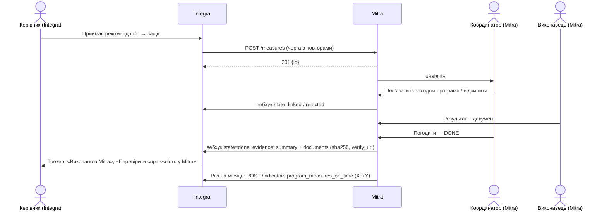

# Integra ↔ Mitra: що зроблено в нас і що потрібно від Mitra

Контракт: [`integra-mitra.yaml`](integra-mitra.yaml). Скопіюйте його в репозиторій Mitra без змін. Кожна команда пише
лише свій бік, код одна одної не беремо.

## Ланцюжок



## Integra (зроблено)

- Надсилання заходів у Mitra: черга `outbox`, фонове надсилання кожні `THEME2_SYNC_SECONDS`, повтори, порядок подій.
- Вебхук статусів з доказом, ідемпотентний; відхиляє посилання не на Mitra, неправильний sha256, «виконано» без доказу, поля з ПІБ.
- Трекер показує стан у Mitra, коментар координатора, документи і посилання на перевірку справжності.
- Показник `program_measures_on_time` (компонент «Система», методика v2.2) приймається від джерела `mitra`.
- Мок Mitra для розробки й запасного демо: `backend/scripts/mitra_mock.py`.

## Mitra (потрібно)

1. **`POST {база}/measures`** за схемою `MeasureUpsert`, ключ `X-Integration-Key`. Повтор з тим самим `id` оновлює запис і
   повертає той самий `id`. Відповідь `201 {"id": "<ваш id>", "state": "inbox"}`.
2. **«Вхідні» координатора**: пов'язати з наявним заходом програми або відхилити з причиною. Нових заходів не створювати.
3. **Вебхук у чергу з повторами** при зміні стану пов'язаного заходу: `POST {Integra}/api/v1/integrations/theme2/measures/status`,
   схема `StatusEvent`. Завжди передавайте `occurred_at`. Відповідність станів:

   | Mitra | `state` |
   |---|---|
   | вхідні / пов'язано / відхилено | `inbox` / `linked` / `rejected` (+ `comment`) |
   | PLANNED, IN_PROGRESS, ON_REVIEW, RETURNED | `planned`, `in_progress`, `on_review`, `returned` |
   | DONE | `done` + `evidence.summary` + `evidence.documents[]` (`name`, `sha256`, `verify_url`) |
   | PARTIAL, NOT_DONE | `partial`, `not_done` (+ `comment` з причиною) |

   Повторювати при мережевій помилці, 408/409/425/429 і 5xx. При 401/404/422 не повторювати, показати адміну.
4. **`/verify` для документа-доказу**: сторінка за `verify_url` показує «документ справжній, внесено тоді-то, sha256 збігається».
   Сховище доказів у Mitra вже рахує sha256; потрібен лише підпис посилання, як для звітів.
5. **Факт** (за бажанням, дуже бажано): раз на місяць по підрозділу `POST {Integra}/api/v1/indicators` зі схемою `Fact`.
   Підрозділи Integra: `GET {Integra}/api/v1/indicators/units` з тим самим ключем.

## Налаштування

| Integra (`.env`) | Значення |
|---|---|
| `THEME2_URL` | база API Mitra для заходів, напр. `http://mitra/api/integrations/integra` |
| `THEME2_API_KEY` | спільний ключ для заходів і вебхуків (той самий у Mitra) |
| `THEME2_PUBLIC_URL` | адреса інтерфейсу Mitra, куди ведуть `url` і `verify_url` (за замовчуванням хост із `THEME2_URL`) |
| `THEME2_SYNC_SECONDS` | як часто надсилати чергу, 10 |
| `INTEGRATION_KEYS` | `mitra=<окремий ключ для фактів>` |
| `PUBLIC_URL` | адреса Integra: з неї Mitra отримує посилання «відкрити захід в Integra» |

Хост в `url` і `verify_url` має збігатися з `THEME2_PUBLIC_URL` буквально: `localhost` і `127.0.0.1` — різні адреси.

## Перевірка без стенду Mitra

```bash
cd backend
python scripts/mitra_mock.py --port 8090 --public http://127.0.0.1:8090 --integra http://127.0.0.1:8000 --key <ключ> --auto 2
# Integra: THEME2_URL=http://127.0.0.1:8090 THEME2_API_KEY=<ключ> THEME2_SYNC_SECONDS=2
# Сторінка мока з кнопками «Пов'язати / Виконано / Відхилити»: http://127.0.0.1:8090/
```
