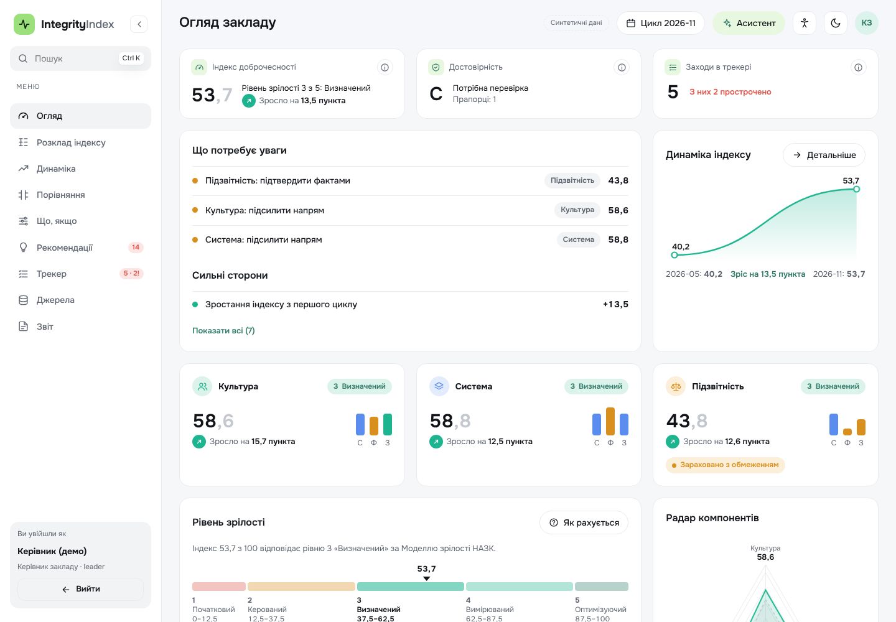
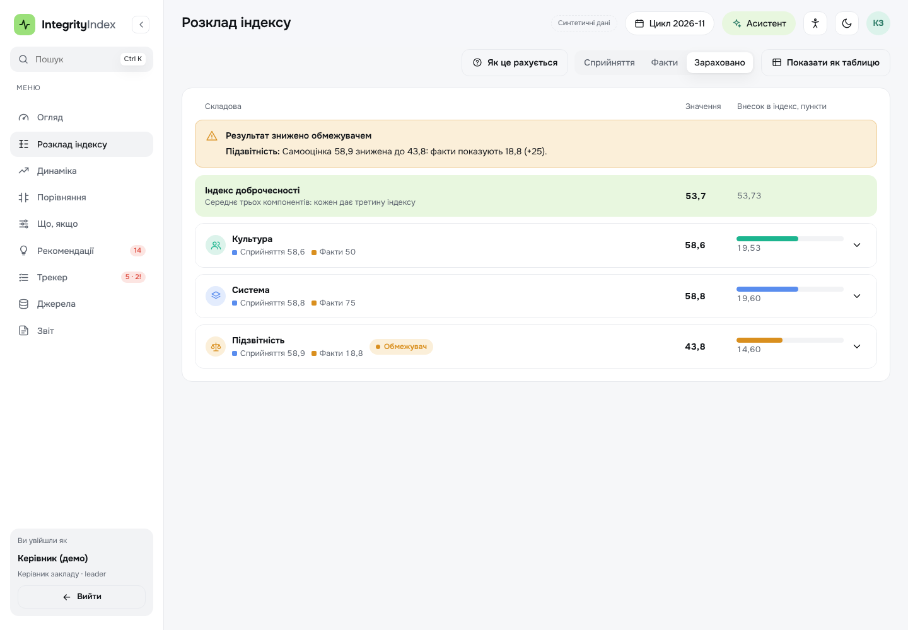
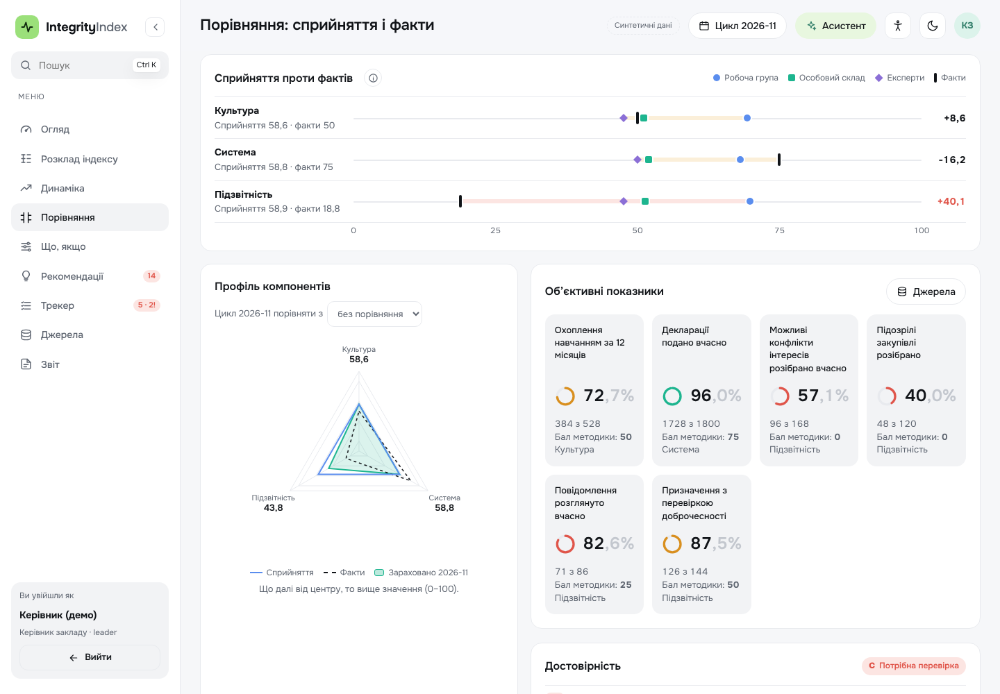

# Dashboard керівника (результат 4)

Принцип умови «один екран — повне розуміння стану системи доброчесності». Екран «Огляд» (`leader`, `auditor`) отримує все
одним запитом `GET /api/v1/dashboard` (за замовчуванням — остання закрита хвиля; керівник підрозділу бачить свій підрозділ).
Числа нижче — з демо-даних «Хвиля 2 (демо)» (ті самі, що в `docs/cross-check.md` і `docs/recommendations.md`).

**Огляд** — індекс, достовірність, заходи, що потребує уваги, динаміка, компоненти, рівень зрілості, радар:

**Розклад індексу** — від інтегрального показника до компонента, з обмежувачем фактами (далі розгортається до питань і пунктів чек-листа):

**Порівняння** — самооцінки РГ, особового складу й експертів проти об'єктивних показників:

Скріншоти зняті з демо-даних (`SEED_WITH_WAVES=true`) під логіном `leader`, 18.11.2026.

## Що на екрані

| Блок | Що показує (демо) | Звідки в API | Деталізація |
|---|---|---|---|
| Integrity Index | **53,7** з 100 · рівень 3 «Визначений» · достовірність **C**; без перевірки фактами було б 58,7 | `index.score`, `index.level`, `index.reliability`, `index.self_score` | Клік → «Розклад індексу»: формула з `index.rule` |
| Три компоненти | Культура 58,6 · Система 58,8 · **Підзвітність 43,8** (самооцінку 58,9 обмежено фактами 18,8 + 25) | `components[]`: `score`, `self_score`, `facts_score`, `cut_by_facts`, `rule` | Клік → джерела S (ОС, РГ, експерти, чек-лист з вагами) → питання й пункти чек-листа |
| Кольорові зони | Сильна сторона ≥ 75 · Задовільно 60–75 · Потребує уваги 40–60 · Критична < 40 | `components[].zone` | Найслабші питання — у «Розкладі індексу» |
| Достовірність | C: «Підзвітність: самооцінку не підтверджують факти» | `index.reliability_reasons` | Прапорці компонентів і груп |
| Участь груп | РГ 100 %, ОС 84 %, експерти 100 %; групи < k — «приховано» | `groups[]` | Лише відсотки, без людей |
| Динаміка | 40,2 → 53,7 (Δ 13,5, «перевірити дані», бо одна з хвиль має достовірність C) | `index_delta`, `index_significance`, `trend[]` | «Динаміка»: усі хвилі, порівняння лише підрозділу із собою |
| Короткий висновок | 3–4 речення: індекс, обрізання фактами, найслабший компонент, зміна | `summary[]` | — |
| Топ-5 рекомендацій | 1. «Підзвітність»: виправити розрив між самооцінкою і фактами (високий) … | `recommendations[]` з `rule`, `decision` | «Рекомендації»: усі 14, рішення, заходи |
| Заходи | Усього, за статусами, прострочені | `measures` | «Трекер»: відповідальний, строк, статус, перевірка наступною хвилею |
| Ризик-сигнали | Сирі кількості знайденого (КІ, закупівлі, повідомлення) і зміна до попереднього кварталу; на індекс не впливають | `risk_signals[]` | «Джерела» |

## Для керівників різних рівнів

- **Керівник закладу** (`leader`) — увесь заклад і будь-який підрозділ через вибір області.
- **Керівник підрозділу** (`leader_a`) — лише свій підрозділ і дочірні (`ensure_unit_access`); дерево підрозділів у фільтрі теж лише своє.
- **Аудитор** (`auditor`) — те саме для читання, плюс журнал дій.
- **Учасник** — окремий екран «Мої результати» (`GET /me/results`, за посиланням `GET /respond/results`): лише узагальнені
  результати закладу й свого підрозділу, без деталей відповідей.

Рейтингу підрозділів немає ніде: підрозділ порівнюється лише із собою в минулих хвилях (принцип «розвиток, а не контроль»).
