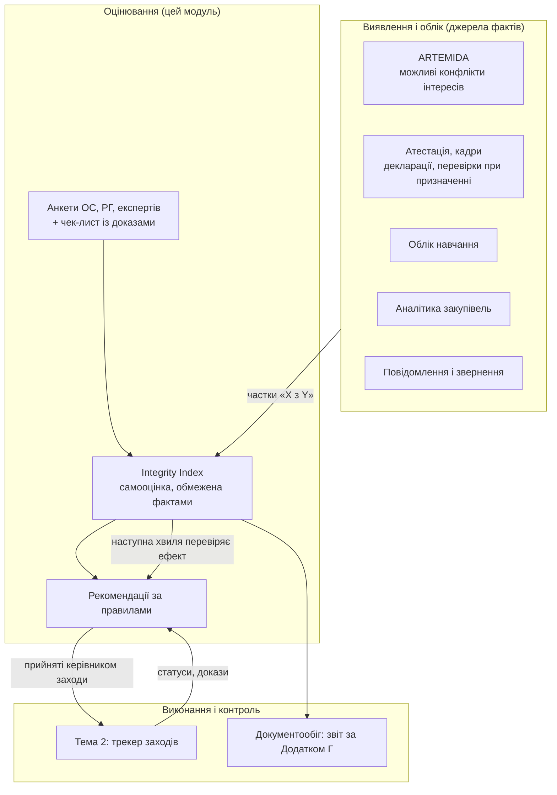

# Концепція інтеграції з іншими рішеннями у сфері доброчесності

Обов'язковий результат 12. Технічні деталі підключень — [`integration-map.md`](integration-map.md).

## Місце рішення в екосистемі

Кожна система доброчесності добре робить свою частину: одна виявляє можливі конфлікти інтересів, друга веде заходи,
третя навчає, четверта аналізує закупівлі. Бракує місця, де керівник бачить **стан системи доброчесності загалом**
і чи дають заходи ефект. Integrity Management Dashboard — цей шар: він не дублює чужі системи, а зводить їхні
агрегати з самооцінкою персоналу в один прозорий показник і повертає рішення назад у системи виконання.

## Принципи

1. **Одноразове оцінювання — багаторазове використання.** Одна хвиля дає індекс, дашборд, порівняння, динаміку,
   рекомендації, звіт і дані для трекера заходів без ручного зведення.
2. **Кожна система лишається власником своїх даних.** До нас приходять лише агрегати за місяць на підрозділ
   («X з Y»). Ми не тягнемо справи, декларації чи звернення й не стаємо їхньою копією.
3. **Мінімум даних.** Жодних персональних даних у потоках між системами; відповідальний за захід — посада;
   групи менші за k не виходять ніде. Зайві поля у фактах відхиляються (422).
4. **Факти обмежують, але не карають.** Факти лише стримують завищену самооцінку. Кількість знайдених проблем на
   бал не впливає: інакше система карала б тих, хто проблеми знаходить, і відбивала б охоту їх шукати.
5. **Слабкий зв'язок.** Кожне джерело — окремий ключ і окремий адаптер; недоступність трекера заходів не
   зупиняє оцінювання (черга з повторами). Будь-яку інтеграцію можна вимкнути, решта працює.
6. **Рішення ухвалює людина.** Рекомендації — явні правила з поясненням; у трекер ідуть лише заходи, прийняті
   керівником. ШІ (локальна Gemma кафедри) лише пояснює вже пораховані числа.
7. **Закритий контур.** Усе працює без зовнішніх хмарних сервісів; моделі й сервіси з РФ, РБ і китайських хмар
   заблоковано в коді.

## Що кожна система отримує від інтеграції

| Система | Дає модулю | Отримує від модуля |
|---|---|---|
| ARTEMIDA (конфлікти інтересів) | частку справ, розібраних вчасно | контекст: у яких підрозділах сприйняття і факти розходяться найбільше, щоб спрямувати увагу |
| Атестація, кадри | частки вчасних декларацій і призначень з перевіркою | рекомендації щодо компонента «Система» |
| Облік навчання | охоплення навчанням | слабкі теми з анкет (питання з найнижчим балом) — що включити в програму |
| Аналітика закупівель | частку розглянутих позначених закупівель | пріоритет компонента «Підзвітність», заходи з Додатку Д |
| Повідомлення і звернення | частку розглянутих вчасно | сигнал довіри персоналу (анкети) поруч із фактами розгляду |
| Тема 2 (трекер заходів) | статуси й докази виконання | прийняті заходи з відповідальним, строком і пунктом Додатку Д; перевірку ефекту наступною хвилею |
| Документообіг | — | звіт за Додатком Г (Word із грифом «Затверджую», Excel) |

## Етапи впровадження

| Етап | Що | Стан |
|---|---|---|
| 1. Ручне внесення | Адміністратор вносить факти через `POST /indicators`; заходи ведуться в модулі | працює |
| 2. Адаптери з ключами | Кожне джерело шле факти своїм адаптером за розкладом; обмін заходами з темою 2 через чергу й вебхук | адаптер ARTEMIDA і 4 моки; тема 2 реалізована, на їхньому стенді не перевірена |
| 3. Масштабування | Інші органи сектору безпеки й оборони: свої підрозділи, анкети (конструктор із версіями) і набір показників без зміни коду методики; зведення по організаціях лише агрегатами | архітектура дозволяє; потребує погодження методики для кожного органу |

## Ризики спільного використання і запобіжники

| Ризик | Запобіжник |
|---|---|
| Індекс використають для покарання керівника чи підрозділу | Немає рейтингів підрозділів, підрозділ порівнюється лише із самим собою; кількість знайденого не знижує бал; достовірність A/B/C поруч із числом |
| Через інтеграцію витечуть персональні дані | Лише агрегати «X з Y», зайві поля → 422; відповідальний — посада; групи < k не передаються |
| Компрометація ключа одного джерела | Ключ прив'язаний до одного `source`: чужі факти не підробити (403); ключ замінюється без зупинки інших |
| Обхід правил через «зручну» систему-джерело | Факти лише обмежують самооцінку й не піднімають її; кожна передача пишеться в журнал дій із ланцюжком хешів |
| Залежність від недоступної системи | Черга з повторами для теми 2; без фактів компонент рахується за самооцінкою з прапорцем `no_facts` |

Детальніше про зловживання — [`abuse-analysis.md`](abuse-analysis.md), про анонімність — [`anonymity.md`](anonymity.md).
