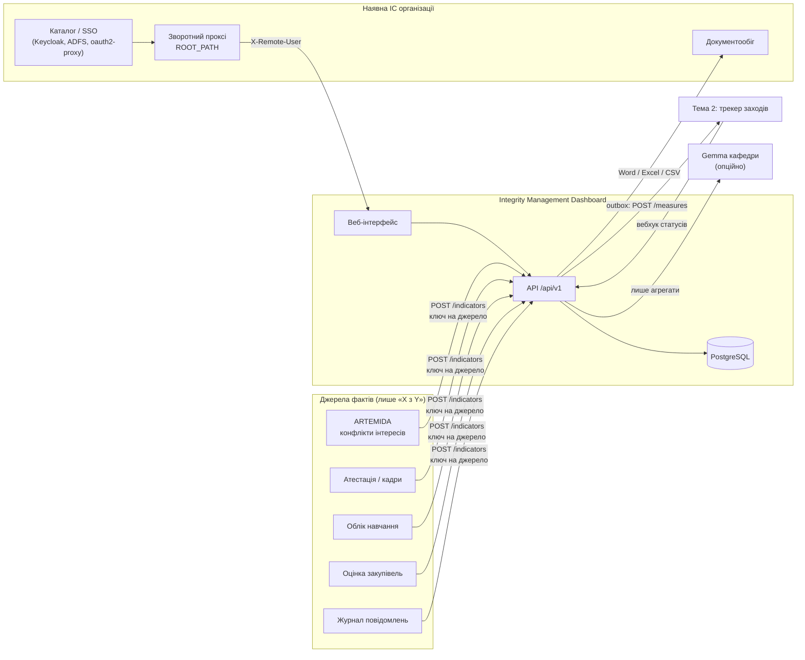

# Карта інтеграції

Обов'язковий результат 9: на базі яких наявних інформаційних систем рішення може працювати як модуль, які API
воно дає і бере, звідки приходять факти. Концепція взаємодії з іншими рішеннями у сфері доброчесності —
[`ecosystem.md`](ecosystem.md).

Рішення — окремий сервіс (API + база + веб-інтерфейс) у закритому контурі, без обов'язкових зовнішніх хмар. Його
можна поставити поруч із наявною ІС організації й підключити до неї з трьох боків: **вхід користувачів** (SSO),
**факти** (агрегати з інших систем), **результати** (заходи, звіти, API для інших панелей).

## 1. Як модуль стає частиною наявної ІС

| Що | Як | Де в коді / налаштуваннях |
|---|---|---|
| Розгортання | Один `docker compose up`: PostgreSQL, API, веб-інтерфейс за nginx. Працює без інтернету | `docker-compose.yml`, `docs/run.md` |
| Під підшляхом наявного порталу | `ROOT_PATH=/imd` за зворотним проксі організації | `ROOT_PATH`, `PUBLIC_URL` |
| Вхід через облікові записи організації | Довірений проксі (Keycloak, ADFS, oauth2-proxy тощо) передає логін у `X-Remote-User`; заголовок приймається лише від адрес із `TRUSTED_PROXIES`, опційно зі спільним секретом. Користувачів автоматично не створюємо: роль і підрозділ призначає адміністратор | `POST /api/v1/auth/proxy`, `services/proxy_auth.py`, `PROXY_AUTH_*`, `TRUSTED_PROXIES` |
| Вимкнути власні паролі | `PASSWORD_LOGIN_ENABLED=false` — лише вхід через SSO | `app/config.py` |
| Структура підрозділів | Дерево `Unit {id, name, parent_id}` будь-якої глибини; задає адміністратор або імпорт | `GET/POST /api/v1/admin/units` |
| Учасники | Явний склад хвилі, імпорт CSV псевдонімів (стовпці з персональними даними відхиляються) або одноразові анонімні посилання | `/campaigns/{id}/participants`, `/campaigns/{id}/tokens` |
| Стан для моніторингу | `GET /health` (з перевіркою БД), `GET /api/v1/config` (без секретів) | `routers/config.py` |
| Журнал дій для внутрішнього аудиту | Ланцюжок хешів, перевірка цілісності | `GET /api/v1/admin/audit-log`, `POST /api/v1/admin/audit-log/verify` |

## 2. Вхідні потоки: факти з інших систем

Методика порівнює самооцінку з об'єктивними показниками. Інші системи передають **лише частку «X з Y» за місяць
на підрозділ** — без імен, ідентифікаторів справ і дат. Будь-яке зайве поле дає 422.

| Джерело (`source`) | Клас системи | Показник | Що рахується | Стан |
|---|---|---|---|---|
| `artemida` | ARTEMIDA — рішення попереднього хакатону щодо конфліктів інтересів | `coi_reviewed` | справи, закриті до строку / виявлені | адаптер читає експорт (`--file`); формат — припущення команди |
| `atestat` | Атестація персоналу, кадрова ІС | `declarations_on_time`, `hiring_checks` | декларації подано вчасно / мали подати; призначення з перевіркою / усі | мок |
| `training` | Облік навчання (LMS, ЕСУ навчанням) | `training_coverage` | пройшли до строку / мали пройти | мок |
| `procurement` | Оцінка закупівель (аналітика на відкритих даних закупівель) | `procurement_flags_reviewed` | позначені закупівлі розглянуто / позначено | мок |
| `reports` | Журнал повідомлень і звернень | `reports_handled` | розглянуто до строку / надійшло | мок |

Як підключається джерело:

1. Адміністратор видає джерелу ключ: `INTEGRATION_KEYS="artemida=…;atestat=…"`. Ключ одного джерела не пускає
   факти іншого (403), невідомий ключ — 401.
2. Адаптер джерела (`backend/adapters/`) читає дані у «рідному» форматі системи, рахує частки й шле
   `POST /api/v1/indicators`. Коди підрозділів зіставляються через `adapters/units.json` і
   `GET /api/v1/indicators/units` (лише `id`, `name`, `parent_id`).
3. Повторна передача того самого місяця оновлює факт (upsert), тож адаптер можна запускати за розкладом.
4. Без адаптера — ручне внесення адміністратором тим самим `POST /indicators`.

Записи, строк яких ще не минув, адаптери не рахують, щоб свіжий місяць не виглядав гіршим. Кількість знайдених
проблем іде в `extra_counts` (ризик-сигнали) і на бал не впливає.

## 3. Вихідні потоки

| Куди | Що | Як | Стан |
|---|---|---|---|
| Тема 2 (трекер заходів) | Прийняті рекомендації як заходи: `id`, `unit_id`, `title`, `description`, `component`, `catalog_number`, `owner` (посада), `due_date`, `status`, `done_on`, `source` | Черга `outbox`: кожна зміна заходу — повідомлення `measure.upsert`; `POST /api/v1/integrations/theme2/sync` шле `POST {THEME2_URL}/measures` із `X-Integration-Key`, невдалі повторюються (до 20 спроб). Їхній `id` зберігається як `external_id` | реалізовано; **на стенді теми 2 ще не перевірено** |
| Тема 2 → ми | Статус заходу | Вебхук `POST /api/v1/integrations/theme2/measures/status` з ключем `THEME2_API_KEY`, за нашим `measure_id` або їхнім `external_id`; «виконано» — лише з доказом | реалізовано, не перевірено з ними |
| Документообіг | Звіт за Додатком Г | `GET /api/v1/campaigns/{id}/report?format=docx\|xlsx\|csv\|json` (Word із грифом «Затверджую») | реалізовано |
| Інші панелі керівника | Індекс, компоненти, динаміка, порівняння хвиль | `GET /api/v1/campaigns/{id}/results`, `/units/{id}/history`, `/units/{id}/compare`, `/dashboard` з роллю `auditor` (лише читання) чи `leader` | реалізовано |
| Методика для пояснень | Ваги, пороги, правила | `GET /api/v1/methodology` | реалізовано |
| Асистент (опційно) | Лише агрегати груп ≥ k | OpenAI-сумісний `/chat/completions` моделі кафедри (Gemma), ключ у `Authorization`; модель сама викликає інструменти бекенду лише на читання | реалізовано; на моделі кафедри ще не перевірено |

Повний контракт API — [`api/openapi.json`](api/openapi.json), відповідність запитам фронтенду —
[`api/frontend-mapping.md`](api/frontend-mapping.md).

## 4. Чого модуль навмисно не бере і не віддає

- Персональних даних: прізвищ, номерів, дат народження. Відповідальний за захід — посада.
- Окремих відповідей респондентів і зв'язку «хто — що відповів»: їх немає навіть у базі (див. [`anonymity.md`](anonymity.md)).
- Цифр для груп, менших за поріг k, — ні в API, ні у звітах, ні в асистенті.
- Подій «хто коли пройшов анкету» в журналі дій.

## 5. Що потрібно від власника системи, щоб підключити її

1. Погодити показник і правило «X з Y» (що чисельник, що знаменник, який строк вважається вчасним).
2. Погодити частоту (раз на місяць або за розкладом) і хто запускає адаптер.
3. Отримати ключ джерела від адміністратора модуля; зберігати його лише в налаштуваннях адаптера.
4. Зіставити свої коди підрозділів з деревом модуля (`units.json`).
5. Перевірити на тестовому стенді: `python -m adapters <джерело> --file <експорт> --dry-run`, потім передача.

## 6. Що ще не перевірено

- Обмін з темою 2 на їхньому стенді: контракт `measures` і вебхук статусів (потрібні адреса стенду й ключ).
- Справжні формати експорту ARTEMIDA та інших систем: зараз — синтетичні моки з правдоподібною структурою.
- Асистент на моделі кафедри (Gemma): чи підтримує вона виклик інструментів; без цього спрацьовує запасний шлях.
