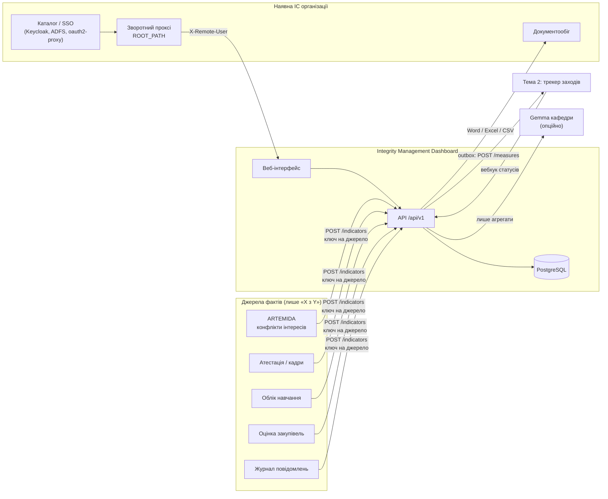

# Карта інтеграції

Обов'язковий результат 9: на базі яких наявних інформаційних систем рішення може працювати як модуль, які API
воно дає і бере, звідки приходять факти. Концепція взаємодії з іншими рішеннями у сфері доброчесності —
[`ecosystem.md`](ecosystem.md).

Рішення — окремий сервіс (API + база + веб-інтерфейс) у закритому контурі, без обов'язкових зовнішніх хмар. Його
можна поставити поруч із наявною ІС організації й підключити до неї з трьох боків: **вхід користувачів** (SSO),
**факти** (агрегати з інших систем), **результати** (заходи, звіти, API для інших панелей).

## 1. Як модуль стає частиною наявної ІС

**Кандидати на ІС-носія** (з документів хакатону, у порядку реалістичності):
1. **Внутрішній портал закладу з SSO** — найпростіше: `ROOT_PATH`, вхід через проксі організації, власні паролі вимкнено.
2. **ЕСУ навчальним процесом ВВНЗ** (згадана в Рекомендаціях) — модуль під її порталом, звідти ж охоплення навчанням і
   анонімне оцінювання викладання (пункт 3.3 чек-листа) як факти.
3. **Система моніторингу Антикорупційної програми (Mitra, тема 2)** — уже інтегровано двобічно: заходи туди, статуси й
   показник `program_measures_on_time` назад.

Закритий контур за умовою означає «без обов'язкової залежності від зовнішніх сервісів», а не «без інтернету»: живі
відкриті джерела (Prozorro, реєстр декларацій НАЗК, API перевірки контрагентів) необов'язкові — `EXTERNAL_FETCH_ENABLED=true`
у compose, їхня недоступність нічого не ламає.

| Що | Як | Де в коді / налаштуваннях |
|---|---|---|
| Розгортання | Один `docker compose up`: PostgreSQL, API, веб-інтерфейс за nginx. Працює без інтернету | `docker-compose.yml`, `docs/run.md` |
| Під підшляхом наявного порталу | `ROOT_PATH=/imd` за зворотним проксі організації | `ROOT_PATH`, `PUBLIC_URL` |
| Вхід через облікові записи організації | Довірений проксі (Keycloak, ADFS, oauth2-proxy тощо) передає логін у `X-Remote-User`; заголовок приймається лише від адрес із `TRUSTED_PROXIES`, опційно зі спільним секретом. Користувачів автоматично не створюємо: роль і підрозділ призначає адміністратор | `POST /api/v1/auth/proxy`, `services/proxy_auth.py`, `PROXY_AUTH_*`, `TRUSTED_PROXIES` |
| Вимкнути власні паролі | `PASSWORD_LOGIN_ENABLED=false` — лише вхід через SSO | `app/config.py` |
| Реальна адреса клієнта за проксі | `FORWARDED_PROXIES`: від цих адрес IP клієнта береться з `X-Forwarded-For` (для лімітів невірних спроб); окремо від `TRUSTED_PROXIES` для SSO. API назовні лише через nginx | `app/security.py::client_ip`, `docker-compose.yml` |
| Робоче розгортання без демо | `SEED_DEMO=false`: лише анкети з Додатків Б і В і адміністратор, без демо-підрозділів, людей, фактів і хвиль | `app/seed/seed.py` |
| Структура підрозділів | Дерево `Unit {id, name, parent_id}` будь-якої глибини; задає адміністратор або імпорт | `GET/POST /api/v1/admin/units` |
| Учасники | Явний склад хвилі, імпорт CSV псевдонімів (стовпці з персональними даними відхиляються) або одноразові анонімні посилання | `/campaigns/{id}/participants`, `/campaigns/{id}/tokens` |
| Стан для моніторингу | `GET /health` (з перевіркою БД), `GET /api/v1/config` (без секретів) | `routers/config.py` |
| Журнал дій для внутрішнього аудиту | Ланцюжок хешів, перевірка цілісності | `GET /api/v1/admin/audit-log`, `POST /api/v1/admin/audit-log/verify` |

## 2. Вхідні потоки: факти з інших систем

Методика порівнює самооцінку з об'єктивними показниками. Інші системи передають **лише частку «X з Y» за місяць
на підрозділ** — без імен, ідентифікаторів справ і дат. Будь-яке зайве поле дає 422.

| Джерело (`source`) | Клас системи | Показник | Що рахується | Стан |
|---|---|---|---|---|
| `artemida` | ARTEMIDA — рішення попереднього хакатону щодо конфліктів інтересів | `coi_reviewed` | справи, закриті до строку / виявлені | адаптер читає експорт (`--file`); формат — припущення команди |
| `atestat` | Атестація персоналу, кадрова ІС | `hiring_checks` | призначення з перевіркою / усі | мок |
| `checks` | Модуль «Перевірки» (усередині Integra): реєстр декларацій НАЗК, Prozorro | `declarations_on_time`, `coi_reviewed`, `procurement_flags_reviewed` | декларації подано вчасно / мали подати; знахідки розглянуто / знайдено | реалізовано |
| `training` | Облік навчання (LMS, ЕСУ навчанням) | `training_coverage` | пройшли до строку / мали пройти | мок |
| `procurement` | Оцінка закупівель (аналітика на відкритих даних закупівель) | `procurement_flags_reviewed` | позначені закупівлі розглянуто / позначено | мок |
| `reports` | Журнал повідомлень і звернень | `reports_handled` | розглянуто до строку / надійшло | мок |

Як підключається джерело:

1. Адміністратор видає джерелу ключ: `INTEGRATION_KEYS="artemida=…;atestat=…"`. Ключ одного джерела не пускає
   факти іншого (403), невідомий ключ — 401.
2. Адаптер джерела (`backend/adapters/`) читає дані у «рідному» форматі системи, рахує частки й шле
   `POST /api/v1/indicators`. Коди підрозділів зіставляються через `adapters/units.json` і
   `GET /api/v1/indicators/units` (лише `id`, `name`, `parent_id`).
3. Повторна передача того самого місяця оновлює факт (upsert), тож адаптер можна запускати за розкладом.
4. Без адаптера — ручне внесення адміністратором тим самим `POST /indicators`.
5. **Власник факту.** Кожен факт передають лише його джерела-власники; не-власник отримує 409 `not_fact_owner`.
   Типово «Декларації вчасно» — модуль «Перевірки» (рахує з реєстру декларацій НАЗК), а не кадрова ІС: так один показник
   не має двох «правд». Якщо заклад бере декларації з кадрової ІС: `FACT_OWNERS="declarations_on_time=atestat"`.
   Повна таблиця власників — `docs/backend.md`, розділ «Адаптери джерел фактів».

Записи, строк яких ще не минув, адаптери не рахують, щоб свіжий місяць не виглядав гіршим. Кількість знайдених
проблем іде в `extra_counts` (ризик-сигнали) і на бал не впливає.

## 3. Вихідні потоки

| Куди | Що | Як | Стан |
|---|---|---|---|
| Mitra, тема 2 (моніторинг виконання антикорупційної програми) | Прийнятий керівником захід: `id`, підрозділ (`id`, шлях назв, код з `units.json`), `title`, `component`, `catalog_number`, `owner` (посада), `due_date`, `status`, посилання назад в Integra | Контракт [`contracts/integra-mitra.yaml`](contracts/integra-mitra.yaml). Черга `outbox` → `POST {THEME2_URL}/measures` з `X-Integration-Key`; фоновий потік шле кожні `THEME2_SYNC_SECONDS` (і `POST /integrations/theme2/sync` вручну). Порядок подій одного заходу зберігається; 4xx не повторюються, видно в `GET /integrations/status` (`theme2_failed`), `?retry_failed=true` повертає їх у чергу. У Mitra захід потрапляє у «вхідні» координатора | реалізовано; перевірено з моком `scripts/mitra_mock.py`, на стенді Mitra ще ні |
| Mitra → ми | Стан заходу: пов'язано / відхилено (з причиною) / в роботі / частково / не виконано / **виконано з доказом**: опис результату і документи з sha256 та посиланням на `/verify` у Mitra | Вебхук `POST /api/v1/integrations/theme2/measures/status` (`THEME2_API_KEY`), за `measure_id` або `external_id`. Ідемпотентний; старіші за `occurred_at` події ігноруються; посилання лише на `THEME2_PUBLIC_URL`. У трекері видно стан Mitra, коментар координатора і кнопку «Перевірити справжність у Mitra» | реалізовано; перевірено з моком |
| Mitra → ми (факт) | `program_measures_on_time`: заходи програми, виконані вчасно, X з Y за місяць (компонент «Система», методика v2.2) | `POST /api/v1/indicators`, `source: mitra`, ключ з `INTEGRATION_KEYS`; підрозділи — `GET /api/v1/indicators/units` | у нас реалізовано; Mitra має почати надсилати |
| Документообіг | Звіт за шаблоном: `appendix_g` (Додаток Г, гриф «Затверджую»), `brief` (довідка керівнику), `measures` (стан Плану заходів), `dynamics` (динаміка між хвилями) | `GET /api/v1/report-templates`; `GET /api/v1/campaigns/{id}/report?format=docx\|xlsx\|csv\|json&template=…` | реалізовано |
| Інші панелі керівника | Індекс, компоненти, динаміка, порівняння хвиль, прогноз «що, якщо» | `GET /api/v1/campaigns/{id}/results`, `/units/{id}/history`, `/units/{id}/compare`, `/dashboard`; `POST /api/v1/campaigns/{id}/what-if` (прогноз від заходів, пунктів чек-листа, цільових фактів; нічого не записує). Роль `auditor` — лише читання | реалізовано |
| Методика для пояснень | Ваги, пороги, правила | `GET /api/v1/methodology` | реалізовано |
| Асистент (опційно) | Лише агрегати груп ≥ k | OpenAI-сумісний `/chat/completions` моделі кафедри (Gemma), ключ у `Authorization`; модель сама викликає інструменти бекенду лише на читання. Редактор звіту: `POST /api/assistant/edit` пропонує заміну виділеного фрагмента, застосовує її людина; числа, яких немає в даних, позначаються попередженням | реалізовано; на моделі кафедри ще не перевірено |

Повний контракт API — [`api/openapi.json`](api/openapi.json), відповідність запитам фронтенду —
[`api/frontend-mapping.md`](api/frontend-mapping.md).

## 4. Чого модуль навмисно не бере і не віддає

- Персональних даних: прізвищ, номерів, дат народження. Відповідальний за захід — посада.
- Окремих відповідей респондентів і зв'язку «хто — що відповів»: їх немає навіть у базі (див. [`anonymity.md`](anonymity.md)).
- Цифр для груп, менших за поріг k, — ні в API, ні у звітах, ні в асистенті.
- Подій «хто коли пройшов анкету» в журналі дій.

## 4а. Що додано 20.11

| Система | Що дає | Як | Стан |
|---|---|---|---|
| Prozorro, реєстр декларацій НАЗК | прапорці закупівель, строки декларацій | модуль «Перевірки», `EXTERNAL_FETCH_ENABLED=true` (тепер за замовчуванням у compose) | живі відкриті API |
| API перевірки контрагентів (Youcontrol чи аналог) | пункт 4.5.1: санкції, банкрутство, борг, суди, «молода» компанія | `POST /checks/counterparty`, `COUNTERPARTY_API_URL/KEY` | адаптер з припущеним форматом відповіді + мок; формат звірити з договором |
| Реєстр корупційних ризиків закладу | ризики, прив'язані до компонента й заходу | `POST /units/{id}/risk-register/import` (CSV) | документ закладу, не система: імпорт таблиці |
| Портал повідомлень викривачів НАЗК | `reports_handled` | адаптер `reports` (публічного API не знайдено: вивантаження або домовленість) | мок |
| Курс «Стоп корупція» на «Дії» | `training_coverage` | адаптер `training` (кількість сертифікатів від кадрового підрозділу) | мок |
| Кадрова ІС | склад учасників без імен (псевдоніми), категорії | імпорт CSV, довідник категорій | ручний імпорт |

## 5. Що потрібно від власника системи, щоб підключити її

1. Погодити показник і правило «X з Y» (що чисельник, що знаменник, який строк вважається вчасним).
2. Погодити частоту (раз на місяць або за розкладом) і хто запускає адаптер.
3. Отримати ключ джерела від адміністратора модуля; зберігати його лише в налаштуваннях адаптера.
4. Зіставити свої коди підрозділів з деревом модуля (`units.json`).
5. Перевірити на тестовому стенді: `python -m adapters <джерело> --file <експорт> --dry-run`, потім передача.

## 6. Що ще не перевірено

- Обмін з темою 2 на їхньому стенді: контракт `measures` і вебхук статусів (потрібні адреса стенду й ключ).
- Справжні формати експорту ARTEMIDA та інших систем: зараз — синтетичні моки з правдоподібною структурою.
- Асистент на моделі кафедри (Gemma): чи підтримує вона виклик інструментів; без цього спрацьовує запасний шлях.
