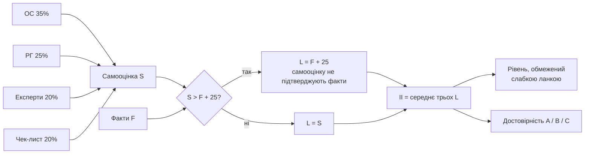

# Методика Integrity Index (v2.3)

Integrity Index показує стан **системи доброчесності організації або підрозділу**, а не людей. Шкала 0–100. Основа — Модель зрілості НАЗК: три компоненти (Культура, Система, Підзвітність) і п'ять рівнів (1 Початковий, 2 Керований, 3 Визначений, 4 Вимірюваний, 5 Оптимізуючий). 1 рівень = 25 балів.

Головні властивості:
- **Детермінованість.** Однакові дані завжди дають однаковий результат. ШІ в розрахунку не бере участі.
- **Прозорість.** Кожне число в API має поле `rule` з поясненням. Уся методика доступна через `GET /api/v1/methodology`.
- **Одне місце для ваг.** Усі ваги й пороги лежать у `backend/app/services/methodology.py`. Методика має версію (`2.3`; `METHODOLOGY_VERSION`), кожен знімок хвилі зберігає версію, за якою його пораховано.

> Ваги джерел 35/25/20/20 **ухвалено командою 20.11.2026** після перевірки стійкості (`GET /campaigns/{id}/sensitivity`):
> зміна кожної ваги на ±10 % не змінює рівня демо-хвиль, найбільший зсув індексу — десяті частки бала. Перегляд — після першого
> реального циклу. Решта порогів — див. «Що затверджує команда».

**Що нового у v2.3.** Розділ «Відвертість» (непрямі питання й «дзеркало», в індекс не входить) і прапорці достовірності
`concealment` (незначний), `pluralistic_ignorance` (інформаційний), `possible_gaming` (незначний, детектор Гудхарта);
категорії респондентів і факти з довідників; рівень, що переважає (`index.modal_levels`, по групах, як у Додатку Г) поруч із
рівнем за середнім балом; ухвалені рішення методики в `GET /methodology` → `decisions`.

## Джерела даних

| Джерело | Що показує | Як потрапляє в систему |
|---|---|---|
| Анкета 2, особовий склад | як систему бачать ті, хто нею користується | анонімне опитування |
| Анкета 1, робоча група | як систему бачать ті, хто її будує | анонімне опитування |
| Анкета 3, зовнішні експерти | зовнішній погляд (ті самі питання, що в Анкеті 1) | анонімне опитування |
| Контрольний чек-лист, 36 пунктів | що зроблено формально | член робочої групи вносить (призначений на пункт, якщо є призначення), підтверджує внутрішній аудит за доказом («повністю» й «частково» — лише з файлом) |
| Інші категорії з довідника (наприклад, курсанти) | порівняння груп; з вагою — ще одне джерело самооцінки | `POST /dictionaries/categories` |
| Факти з інших систем | що показують дані | `POST /indicators`, лише кількості «X з Y», без імен |

## Розрахунок



### Крок 1. Самооцінка компонента S

```
S = 0,35·ОС + 0,25·РГ + 0,20·Експерти + 0,20·Чек-лист
```

- ОС, РГ, Експерти — бал компонента в групі: середнє зважене нормованих балів питань розділу.
- Якщо в групі менше k відповідей (за замовчуванням 5), вона випадає, а її вага ділиться між рештою **пропорційно**. Якщо випала категорія респондентів, ставиться прапорець `low_participation`.
- Чому такі ваги: особовий склад «користується» системою, робоча група її будує і схильна завищувати, експерт дає зовнішній погляд.

**Чек-лист** розподілено між компонентами:

| Компонент | Пункти | Кількість |
|---|---|---|
| Культура | 1.2, 1.3, 2.6, 2.8, 5.1–5.5 | 9 |
| Система | 1.1, 2.1–2.5, 3.1, 3.3 | 8 |
| Підзвітність | 2.7, 3.2, 3.4, 4.1.1–4.6.2, 6.1–6.4 | 19 |

Бал пункту: «повністю» = 100, «частково» = 50, «підлягає впровадженню» = 0. **«Повністю» без підтвердження рахується як 50.** Підтвердити пункт можна лише з доказом, тому підтверджений пункт завжди має доказ. Чек-лист компонента — середнє заповнених пунктів.

Розділ 4 анкет («Загальна самооцінка рівня зрілості») в індекс не входить. Його порівнюють з розрахованим рівнем як сигнал завищення.

### Крок 2. Рівень за фактами F

Кожен факт — частка «X з Y». Вона переводиться в рівень 1–5 за порогами, а далі в бали `(рівень − 1) × 25`. F — середнє фактів компонента.

| Факт (`indicator`) | Компонент | 1 | 2 | 3 | 4 | 5 |
|---|---|---|---|---|---|---|
| `declarations_on_time` — декларації вчасно / мали подати | Система | <80% | 80–89 | 90–94 | 95–98 | ≥99 |
| `training_coverage` — пройшли навчання за 12 міс / мали | Культура | <50% | 50–69 | 70–84 | 85–94 | ≥95 |
| `coi_reviewed` — можливі КІ розібрано вчасно / знайдено | Підзвітність | <60% | 60–74 | 75–89 | 90–97 | ≥98 |
| `procurement_flags_reviewed` — підозрілі закупівлі розібрано / позначено | Підзвітність | <50% | 50–69 | 70–84 | 85–94 | ≥95 |
| `reports_handled` — повідомлення розглянуто вчасно / надійшло | Підзвітність | <70% | 70–84 | 85–94 | 95–99 | 100 |
| `hiring_checks` — призначення з перевіркою / всі призначення | Підзвітність | <70% | 70–84 | 85–94 | 95–99 | 100 |
| `program_measures_on_time` — заходи антикорупційної програми виконано вчасно / мали бути виконані (джерело — Mitra, тема 2; з v2.2) | Система | <60% | 60–74 | 75–89 | 90–97 | ≥98 |

- Для індексу хвилі беруться факти за **4 останні завершені квартали** до закриття хвилі (хвиля, закрита 17.11.2026, бере
  жовтень 2025 — вересень 2026), по підрозділу разом із дочірніми. У v2.0 це були 12 місяців до місяця закриття включно;
  v2.1 рахує лише цілі квартали, щоб різницею періодів не можна було отримати значення за окремий місяць (див. `anonymity.md`).
- Якщо знаменник дорівнює 0, факт не враховується. Якщо знаменник менший за k — у періоді **або в будь-якому кварталі
  періоду**, — цифри не показуються і в індекс підрозділу не йдуть: вони враховуються лише у вищому підрозділі.
- **В індекс іде лише частка.** Кількість знайдених проблем на бал не впливає, інакше система карала б тих, хто проблеми знаходить.

### Крок 3. Правило реальності

```
якщо S > F + 25  →  L = F + 25, прапорець self_not_confirmed (серйозний)
якщо F > S + 25  →  L = S,      прапорець unaware_of_mechanisms (інформаційний)
інакше           →  L = S
фактів немає     →  L = S,      прапорець no_facts (незначний)
```

Факти лише обмежують самооцінку, але ніколи її не піднімають.

### Крок 4. Індекс і рівень

- `II = (L_культура + L_система + L_підзвітність) / 3`.
- Рівень визначається округленням `1 + 4 × II / 100`: межі 12,5 / 37,5 / 62,5 / 87,5.
- **Слабка ланка:** загальний рівень не може бути вищим за рівень найслабшого компонента + 1. Обмежується лише рівень, бал лишається.
- Система віддає **обидва числа**: `index.score` (з фактами) і `index.self_score` (лише самооцінка). Так видно, наскільки факти «зрізали» результат.

### Крок 5. Достовірність A / B / C

| Прапорець | Умова | Вага |
|---|---|---|
| `low_participation` | участь категорії менше 60% або категорія випала (n < k) | незначний |
| `category_gap` | \|РГ − ОС\| на спільних питаннях компонента більше 25 балів | серйозний |
| `suspiciously_perfect` | понад 30% анкет групи мають лише найвищі відповіді | серйозний |
| `self_not_confirmed` | спрацювало правило реальності | серйозний |
| `checklist_unconfirmed` | підтверджено менше 50% пунктів чек-листа | незначний |
| `no_facts` | для компонента немає фактів | незначний |

**A** — немає прапорців. **B** — 1–2 незначних. **C** — хоч один серйозний або 3 і більше незначних. Якщо даних менше порогу, замість літери пишемо «недостатньо даних». Достовірність індексу дорівнює найгіршій серед компонентів. Причини повертаються в `index.reliability_reasons`, щоб показувати їх поруч із літерою.

## Приклад розрахунку

Перевіряється тестом `test_example_from_methodology`. Значення в таблиці подано в рівнях (1–5), щоб їх було легко читати.

| | ОС | РГ | Експ. | Чек-лист | S | Факти | F | L |
|---|---|---|---|---|---|---|---|---|
| Культура | 2,6 | 3,4 | 2,8 | 3,2 | 2,96 | навчання 72% → 2 | 2 | 2,96 |
| Система | 2,9 | 3,8 | 3,0 | 3,8 | 3,33 | декларації 96% → 4 | 4 | 3,33 |
| Підзвітність | 2,2 | 3,9 | 2,5 | 3,4 | 2,93 | КІ 55% → 1, закупівлі 40% → 1, повідомлення 80% → 2 | 1,33 | **2,33** |

- Культура: S = 0,35·2,6 + 0,25·3,4 + 0,20·2,8 + 0,20·3,2 = 2,96. Факти 2, і 2,96 не перевищує 2 + 1, тому L = 2,96.
- Підзвітність: S = 2,93, факти 1,33. Оскільки 2,93 > 1,33 + 1, компонент обмежується до 2,33.
- II = 100 × ((2,96 + 3,33 + 2,33) / 3 − 1) / 4 ≈ **47**. Без перевірки фактами було б **52**.
- Рівень «Визначений». Достовірність **C**: у Підзвітності спрацювали `self_not_confirmed` і `category_gap` (РГ 3,9 проти ОС 2,2, тобто 42,5 бала).

Головний рядок для UI:

> **47 балів · Визначений · достовірність C** — Підзвітність: самооцінку не підтверджують факти

## Динаміка

- **Знімок при закритті хвилі.** Для підрозділу хвилі і кожного дочірнього зберігаються всі бали, S, F, L, обидва індекси, достовірність, прапорці, кількості, версія методики й дата. Знімок незмінний.
- **Зміна методики.** Старі знімки показуються з позначкою версії. Параметр `?recalculate=true` дає окремий перерахунок за поточною методикою, оригінал не перезаписується.
- **Правило значущості.** Якщо |Δ| < 5 балів, пишемо «в межах похибки». Якщо одна з двох хвиль має достовірність C, пишемо «перевірити дані». Інакше «покращилось» або «погіршилось».
- **Порівнюємо підрозділ лише із самим собою.** Рейтингу підрозділів немає.

## Захист анонімності

- Будь-які цифри, і відповіді, і кількості, показуються лише для групи від k людей. Це стосується і прогресу хвилі, і кількості відповідей у групі, і знаменників фактів.
- Якщо група менша за поріг, її дані враховуються у вищому підрозділі.
- Результати рахуються лише після закриття хвилі.
- Перегляд результатів **чужого** підрозділу (не свого, не кореня хвилі й не закладу) пишеться в `result_views` з будь-якого ендпойнта результатів: дашборд, результати, історія, порівняння, рекомендації, «Що, якщо», «Питання перевірки», звіти, факти, ризики, асистент. Звіт для аудиту: `GET /admin/result-views`. Перегляди свого підрозділу не пишуться ніде. У журнал дій з ланцюжком хешів ідуть лише дії (перерахунок, експорт звіту, рішення, зміни): запис туди блокує голову ланцюжка, і кожне читання ставало б у чергу.
- **Відомий ризик — атака різницею:** агрегат малого підрозділу теоретично можна отримати як «вищий підрозділ мінус інші». Запобіжник у MVP — вторинне приховування, журнал переглядів чужих підрозділів і обмежене коло ролей (керівник бачить деталі лише свого підрозділу). У промисловій версії варто забороняти деталізацію, якщо сусідній підрозділ менший за поріг.

## API

| Ендпоінт | Хто | Що повертає |
|---|---|---|
| `GET /methodology` | усі, хто увійшов | ваги, пороги, рівні, прапорці, правила |
| `GET /campaigns/{id}/results?unit_id=&recalculate=` | admin, leader, auditor, department | знімок: індекс, компоненти з S/F/L і джерелами, групи, чек-лист, факти, питання з розподілом, динаміка, висновок |
| `GET /units/{id}/history` | admin, leader, auditor, department | усі хвилі підрозділу для графіка: index, index_self, компоненти, достовірність, значущість |
| `GET /units/{id}/compare?from_campaign=&to_campaign=` | admin, leader, auditor, department | дві будь-які хвилі: дельти зі значущістю, радар «було / стало» |
| `GET /me/results` | respondent | екран учасника: узагальнені результати без деталей |
| `GET/PUT /campaigns/{id}/checklist[/{question_id}]` | робоча група вносить; admin, auditor переглядають | стан чек-листа |
| `POST/DELETE /campaigns/{id}/checklist/{question_id}/confirm` | auditor (`CHECKLIST_CONFIRMERS`) | підтвердити або відкликати підтвердження |
| `POST /indicators` | інша система (`X-Integration-Key`) або admin | прийом факту за місяць; зайві поля дають 422 |
| `GET /units/{id}/indicators?months=3\|6\|12` | admin, leader, auditor, department | факти у форматі «X з Y» |
| `GET /units/{id}/risk-signals?months=` | admin, leader, auditor, department | сирі кількості знайденого та їх зміна; на індекс не впливає |

## Чого система свідомо не робить

- Не оцінює конкретних людей і не зберігає імен у фактах.
- Не порівнює підрозділи між собою.
- Не карає за знайдені проблеми: рахує, як їх розбирають.
- ШІ не рахує бали й не ухвалює рішень.
- Не показує жодних цифр для груп, менших за k.

## Рівень за середнім і рівень, що переважає

Рівень індексу рахується із середнього балу: він враховує всі відповіді й чутливий до змін між хвилями. Додаток Г визначає рівень
якісно — за варіантом, що переважає, окремо по кожній групі. Обидва показники є: `index.level` (середнє) і `index.modal_levels`
(`{"staff": 3, "working_group": 4, ...}`), звіт за Додатком Г і далі будується з модальних рівнів.

## Відвертість і підгонка (v2.3)

- **Детектор відвертості** (`services/candor.py`): непряма оцінка частки «стикався з чутливою ситуацією» (B − A) з інтервалом 95 %,
  пряма частка, розрив; «дзеркало» — «я так» проти «колеги так». Прапорці: `concealment` — розрив ≥ 10 п. п. і нижня межа
  інтервалу вища за пряму частку; `pluralistic_ignorance` — розрив ≥ 20 п. п. Мінімум ≥ max(k, 30) відповідей на варіант.
- **Детектор Гудхарта** (`services/goodhart.py`): 5 правил підгонки; будь-який сигнал → `possible_gaming`.
- **Лотерея перевірок**: пункти чек-листа для глибокої перевірки аудитом за хешем знімка.

## Ухвалені рішення

| Рішення | Чому |
|---|---|
| Ваги 35/25/20/20 | ОС — ті, хто користується системою; РГ схильна завищувати; експерти й чек-лист — зовнішній і формальний погляд. Стійкість ±10 % перевірено |
| «Робота з викривачами»: бали 1, 2, 3, 4, 5, 5 | Шостий варіант Додатку В доповнює п'ятий (обидва — «Оптимізуючий»); шкалу 1-5 не розтягуємо |
| Анкета 3 = питання Анкети 1 | У Додатку В Анкети 3 немає; питання Анкети 1 стосуються системи, тож експерти зіставні з РГ |
| Розділ 4 анкет в індекс не входить | Заявлений рівень — сигнал завищення, а не оцінка механізмів |
| Рівень із середнього, поруч модальний | Див. розділ вище |

## Що затверджує команда

- Ваги джерел 35 / 25 / 20 / 20 (ухвалено 20.11.2026, див. вище).
- Пороги фактів (таблиця в кроці 2).
- Розподіл 36 пунктів чек-листа між компонентами.
- Пороги достовірності: участь 60%, розбіжність 25 балів, «ідеальні» анкети 30%, підтверджений чек-лист 50%, 3 незначні прапорці для C.
- Анкету для експертів: зараз вона повторює питання Анкети 1, щоб оцінки можна було зіставити.
